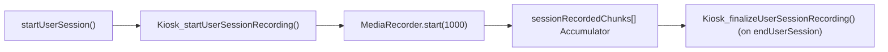

# Function: `Kiosk_startUserSessionRecording`

## 1. Why Added
When a customer starts interacting with the kiosk (touching the screen or choosing Bin/Vending), an audited session video recording must capture the exact user interaction. Starting a session-specific recorder captures customer activity independently of the continuous background surveillance loop.

## 2. Importance & Criticality
Ensures fraud prevention, dispute resolution, and regulatory compliance. Every transaction (diaper drop-off or vending purchase) is cryptographically and visually paired with a standalone video recording spanning the entire customer interaction.

## 3. Signature & Contracts
```typescript
function startUserSessionRecording(sessionId: string, stream: MediaStream): void
```
- **Inputs**:
  - `sessionId: string` (e.g., `SESS-MWIW15NQ`).
  - `stream: MediaStream` (active hardware webcam stream).
- **Outputs**: `void`.

## 4. Behavior & Logic
1. Records `sessionStartTime = new Date()`.
2. Initializes dedicated array `sessionRecordedChunks = []`.
3. Instantiates `sessionRecorder = new MediaRecorder(stream, options)`.
4. Appends incoming chunks via `ondataavailable`.
5. Starts recording with 1-second timeslices (`sessionRecorder.start(1000)`).
6. Updates UI lens indicator to active recording state.

## 5. Pipeline Integration & Mapping

