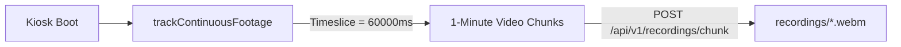

# Function: `trackContinuousFootage`

## 1. Why Added
To govern uninterrupted 1-minute video chunking from the moment the camera feed activates on boot, and accurately correlate timestamp intervals with customer interaction sessions.

## 2. Importance & Criticality
- **Continuous Surveillance**: Ensures no gap in video recording exists between customer visits.
- **Session Temporal Mapping**: Links customer interaction windows (`[sessionStartTime, sessionEndTime]`) directly to the chunk files stored in `recordings/`.

## 3. Signature & Contracts
```typescript
function trackContinuousFootage(chunkDurationMs?: number): void;
```
- **Inputs**:
  - `chunkDurationMs` (number, optional, default: 60000 = 1 minute).
- **Outputs**: None. Mutates recording configuration and interval.
- **State Modifications**:
  - `CHUNK_INTERVAL_MS`: Configured to 60,000 ms.
  - Video chunks emitted every 60 seconds with active naming.

## 4. Behavior & Logic
1. Starts `MediaRecorder` with 60000ms timeslice upon `initKioskCameraFeed()`.
2. Emits `SURV_chunk_XXXX_*.webm` files while kiosk is in standby (Page 1).
3. Seamlessly updates chunk prefix to `SESS-XXXX_chunk_YYYY_*.webm` as soon as user taps the screen to start a session.
4. On session end, records start timestamp, end timestamp, total duration, and chunk file list in `data/sdds-state.json`.

## 5. Pipeline Integration & Connection Mapping
- **Upstream Caller**: `initKioskCameraFeed()` and `startChunkedRecording()`.
- **Downstream Targets**: `dispatchVideoChunk()` and `recordings/` directory.


