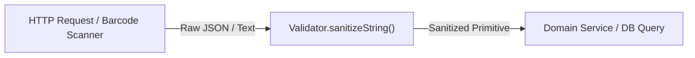

# Function: `Validator.sanitizeString`

- **Module / File**: `packages/shared/src/schemas/validator.ts`
- **Component**: `Shared Runtime Validation Subsystem`
- **Author / Agent**: `Antigravity`
- **Date Created**: `2026-11-11`

---

## 1. Why Was This Function Added? (Rationale)
APIs and hardware scanner inputs can receive malicious payloads, including NoSQL injection attacks (e.g. `{"$gt": ""}`) or script tags. This function guarantees strict type enforcement, trims input, bounds string lengths, and blocks reserved query operators.

## 2. Importance & Criticality
- **System Role**: First line of defense for every API request across both Collection Bin and Vending Machine.
- **Impact of Failure**: Risk of NoSQL injection bypass or database corruption.
- **SLA / Performance Requirement**: Sub-microsecond regex/character check.

## 3. Function Signature & Contracts

```typescript
public static sanitizeString(
  input: unknown,
  fieldName: string,
  minLen?: number,
  maxLen?: number
): string
```

### Parameters
| Name | Type | Required | Description | Constraints / Validation |
| :--- | :--- | :--- | :--- | :--- |
| `input` | `unknown` | Yes | Raw incoming input value | Must be a primitive string |
| `fieldName` | `string` | Yes | Name of the field for error context | Non-empty string |
| `minLen` | `number` | No (default: 1) | Minimum allowed length | Integer $\ge 0$ |
| `maxLen` | `number` | No (default: 255) | Maximum allowed length | Integer $\le 65535$ |

### Return Value
- **Type**: `string` (sanitized and trimmed string).

### Thrown Exceptions
- `ValidationError`: When type is not string, length out of bounds, or starts with `$`.

---

## 4. Pipeline Integration & Connection

### Upstream Callers & Data Source
- **Trigger**: Express route controllers, webhook parsers, and barcode scanner inputs.
- **Callers**: `CartController`, `RewardController`, `OrderController`.

### Downstream Targets & Consumers
- **Next Stage**: Type-safe service layers and MongoDB query builders.

### Integration Flow Diagram


---

## 5. Memory Alignment & Resource Optimization
- Reuses string primitives without deep object allocation.
- In-place checks for `$` character.
- **Time Complexity**: $O(N)$ where $N$ is string length.
- **Space Complexity**: $O(1)$.

---

## 6. Security Analysis
- Actively blocks MongoDB operator injection by disallowing keys/values beginning with `$`.
- Enforces strict length boundaries to prevent Denial-of-Service via huge string allocations.

