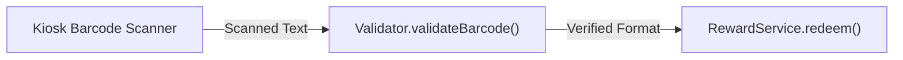

# Function: `Validator.validateBarcode`

- **Module / File**: `packages/shared/src/schemas/validator.ts`
- **Component**: `Shared Runtime Validation Subsystem`
- **Author / Agent**: `Antigravity`
- **Date Created**: `2026-11-11`

---

## 1. Why Was This Function Added? (Rationale)
The vending machine accepts scanned input from USB laser barcode scanners. Scanners can misread, receive noisy keystrokes, or be attacked with malicious code strings. This function validates that the string strictly matches the SDDS Code 128 format.

## 2. Importance & Criticality
- **System Role**: Format validation prior to database lookup.
- **Impact of Failure**: Malformed scanner input could cause unhandled exceptions or query errors.

## 3. Function Signature & Contracts

```typescript
public static validateBarcode(barcode: unknown): string
```

### Parameters
| Name | Type | Required | Description | Constraints / Validation |
| :--- | :--- | :--- | :--- | :--- |
| `barcode` | `unknown` | Yes | Raw string read from the kiosk barcode scanner | Regex `^SDDS-[0-9A-F]+-[0-9A-F]+-[0-9A-F]+$` |

### Return Value
- **Type**: `string` (Upper-cased valid barcode string).

### Thrown Exceptions
- `ValidationError`: When the string fails format rules.

---

## 4. Pipeline Integration & Connection

### Upstream Callers & Data Source
- **Trigger**: Barcode scan event at kiosk.
- **Caller**: `POST /api/v1/rewards/scan`

### Downstream Targets & Consumers
- **Next Stage**: `verifyBarcodeSignature()` and MongoDB lookup in `rewards` collection.

### Integration Flow Diagram


---

## 5. Memory Alignment & Resource Optimization
- Single regex execution, zero memory leakage.
- **Time Complexity**: $O(1)$
- **Space Complexity**: $O(1)$

