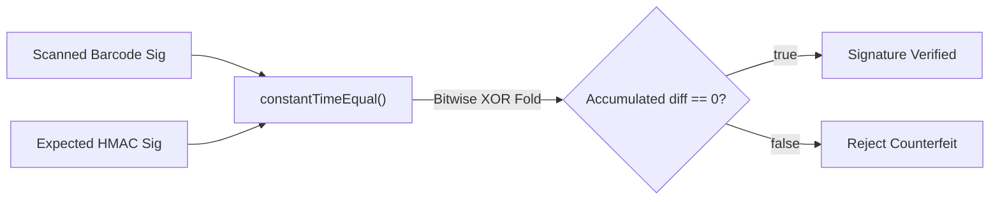

# Function: `constantTimeEqual`

- **Module / File**: `packages/shared/src/utils/crypto.ts`
- **Component**: `Shared Cryptographic Engine`
- **Author / Agent**: `Antigravity`
- **Date Created**: `2026-11-11`

---

## 1. Why Was This Function Added? (Rationale)
Standard string equality (`===`) or standard array comparisons short-circuit on the first mismatched byte, leaking execution time differentials that allow attackers to infer valid barcode signatures byte-by-byte (timing attack side channel). This function performs an unvarying, constant-time XOR fold over the entire byte array.

## 2. Importance & Criticality
- **System Role**: Defends against side-channel timing analysis attacks during barcode verification.
- **Impact of Failure**: Vulnerability to statistical timing attacks.

## 3. Function Signature & Contracts

```typescript
export function constantTimeEqual(a: Uint8Array, b: Uint8Array): boolean
```

### Parameters
| Name | Type | Required | Description | Constraints / Validation |
| :--- | :--- | :--- | :--- | :--- |
| `a` | `Uint8Array` | Yes | First byte array | Memory-aligned Uint8Array |
| `b` | `Uint8Array` | Yes | Second byte array | Memory-aligned Uint8Array |

### Return Value
- **Type**: `boolean` (`true` if identical; `false` otherwise).

---

## 4. Pipeline Integration & Connection

### Upstream Callers & Data Source
- **Caller**: `verifyBarcodeSignature()`.

### Downstream Targets & Consumers
- **Next Stage**: Authenticates barcode validity before issuing discount in `RewardService`.

### Integration Flow Diagram


---

## 5. Memory Alignment & Resource Optimization
- Single linear loop with zero intermediate allocations.
- Constant time execution independent of content differences.
- **Time Complexity**: $O(N)$ where $N$ is array length.
- **Space Complexity**: $O(1)$.

