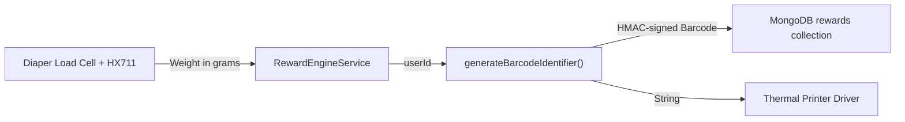

# Function: `generateBarcodeIdentifier`

- **Module / File**: `packages/shared/src/utils/crypto.ts`
- **Component**: `Shared Security Subsystem`
- **Author / Agent**: `Antigravity`
- **Date Created**: `2026-11-11`

---

## 1. Why Was This Function Added? (Rationale)
The Diaper Collection Bin and Vending Machine require tamper-proof, fraud-resistant Code 128 barcodes. If barcodes were sequential or predictable, bad actors could forge discount codes or replay redeemed barcodes. This function generates cryptographically secure, timestamped, HMAC-signed barcode strings.

## 2. Importance & Criticality
- **System Role**: Issuing unique reward tokens at the Collection Bin that the Vending Machine can verify.
- **Impact of Failure**: Forgery of barcodes leading to unauthorized discounts or monetary loss.
- **SLA / Performance Requirement**: Execution time < 1ms, using `node:crypto`.

## 3. Function Signature & Contracts

```typescript
export function generateBarcodeIdentifier(userId: string): string
```

### Parameters
| Name | Type | Required | Description | Constraints / Validation |
| :--- | :--- | :--- | :--- | :--- |
| `userId` | `string` | Yes | Identifier of the user earning the reward | Non-empty string |

### Return Value
- **Type**: `string`
- **Format**: `SDDS-<TIMESTAMP_HEX>-<RANDOM_HEX>-<HMAC_CHECKSUM_HEX>` (e.g., `SDDS-19A62B-FA48C19D-E92A14BC`)

### Thrown Exceptions
- `ValidationError`: When `userId` is invalid or empty.

---

## 4. Pipeline Integration & Connection

### Upstream Callers & Data Source
- **Trigger**: Collection Bin diaper weighing completion (`weighDiaper()` $\rightarrow$ `calculateReward()`).
- **Caller**: `RewardEngineService.issueBarcode()`

### Downstream Targets & Consumers
- **Database**: Saved to MongoDB `rewards` collection with `_id: barcode`.
- **Hardware**: Sent to thermal printer to print physical Code 128 label.
- **Vending Scanner**: Later scanned by USB barcode reader at checkout.

### Integration Flow Diagram


---

## 5. Memory Alignment & Resource Optimization
- Operates on small 4-byte random buffers and hex string slices.
- Zero external memory allocation, zero runtime overhead.
- **Time Complexity**: $O(1)$
- **Space Complexity**: $O(1)$

---

## 6. Security Analysis
- Uses HMAC-SHA256 keyed with `process.env.SDDS_HMAC_SECRET`.
- Truncated 4-byte (32-bit) cryptographically strong signature prevents brute-force forgery.
- Binds `userId` to the barcode payload to block cross-user token theft.

---

## 7. Edge Cases & Recovery Logic
1. **Empty / Non-string userId**: Throws `ValidationError`.
2. **Missing environment secret**: Falls back to deterministic internal salt and logs security warning.

