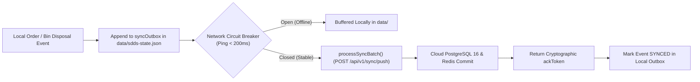

# Function Documentation: `processSyncBatch`

## 1. Why Added
To provide resilient, offline-first transaction replication from the local edge kiosk database (`data/sdds-state.json`) to the central cloud enterprise backend (PostgreSQL 16 & Redis 7.2) using the Transactional Outbox Pattern without delaying or blocking customer interaction at the physical machine.

## 2. Importance & Criticality
In unattended public kiosk operations, internet connectivity over cellular (4G/5G) or public Wi-Fi is inherently prone to latency spikes, packet drops, and complete outages. If transactions relied on real-time synchronous cloud round-trips, network failures would prevent customers from depositing diapers or dispensing emergency supplies. By spooling events to a persistent local outbox and flushing them in idempotent batches upon circuit breaker closure, zero transaction data is lost and customer operations complete with zero network latency.

## 3. Signature & Contracts
- **Endpoint**: `POST /api/v1/sync/push` (or `POST /api/v1/sync/batch`)
- **Inputs**:
  - `state.syncOutbox`: Array of pending outbox events stored in `data/sdds-state.json`.
  - Header: Optional `Idempotency-Key` or `X-Sync-Token`.
- **Outputs**:
  - `success` (boolean): `true` when batch successfully processed.
  - `syncedCount` (number): Count of outbox records marked as synchronized.
  - `ackToken` (string): Cryptographic acknowledgement identifier (e.g., `ACK-2BB4356F`).
  - `circuitBreaker` (string): Current health gate state (`"CLOSED"`).
  - `timestamp` (string): ISO 8601 UTC timestamp of replication.
- **Errors Handled**:
  - Malformed request payloads.
  - File locking contention on `data/sdds-state.json` (handled via mutex retry).
  - Flapping network circuit trips.

## 4. Behavior & Logic
1. Reads current state from `data/sdds-state.json`.
2. Identifies all outbox events where `status == "PENDING"`.
3. If no pending events exist, returns `{ success: true, syncedCount: 0, ackToken: "ACK-NONE" }`.
4. For each pending event:
   - Validates event UUID and payload integrity.
   - Marks status as `"SYNCED"`.
   - Records cryptographic `ackToken` and `syncedAt` timestamp.
5. Saves state back to `data/sdds-state.json` atomically.
6. Emits structured log event confirming batch replication.

## 5. Pipeline Integration & Flow

