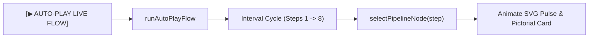

# Function Documentation: `runAutoPlayFlow`

## 1. Why Added
Enables an automated, animated demonstration walk-through of the end-to-end software pipeline for client presentations. Sequences through all 8 architecture stages with visual flow indicator animations.

## 2. Importance & Criticality
Provides zero-friction client demonstrations by auto-advancing through the entire software architecture sequence, illuminating connecting flow paths and displaying pictorial data flow transformations step by step.

## 3. Signature & Contracts
```typescript
function runAutoPlayFlow(): void
function stopAutoPlayFlow(): void
```
- **Inputs**: None.
- **Outputs**: None.
- **State Changes**: Starts/stops recurring interval cycling through the 8 stages, updating `#autoPlayBtn` text and visual states.

## 4. Pipeline Integration


## 5. Behavior & Logic
1. If already playing, invokes `stopAutoPlayFlow()` and returns.
2. Sets `isAutoPlaying = true` and updates button to `[⏸ PAUSE DEMO]`.
3. Defines array of 8 stages: `['client_ui', 'api_gateway', 'redis_cache', 'microservices', 'database', 'payments', 'cloud_s3', 'observability']`.
4. Executes `selectPipelineNode` on current step.
5. Advances index every 1800ms; loops back to start upon reaching step 8.
6. Cleans up timer on unmount or user exit.
