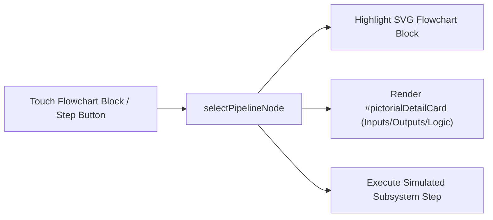

# Function Documentation: `selectPipelineNode`

## 1. Why Added
Provides a rich, interactive pictorial inspection of any software architecture subsystem in `#viewServerProcessing`. Replaces legacy raw terminal console text dumps with a visual flowchart breakdown and client presentation guide.

## 2. Importance & Criticality
Essential for explaining the enterprise software pipeline to clients and evaluators. Allows instant visual inspection of inputs, transformation algorithms, and downstream outputs for all 8 subsystems without confusing raw log clutter.

## 3. Signature & Contracts
```typescript
function selectPipelineNode(nodeKey: string, autoTrigger?: boolean): void
```
- **Inputs**:
  - `nodeKey`: Subsystem identifier (`client_ui`, `api_gateway`, `redis_cache`, `microservices`, `database`, `payments`, `cloud_s3`, `observability`).
  - `autoTrigger`: Optional boolean (default `true`) to execute live simulated edge dispatch.
- **Outputs**: None (updates pictorial DOM elements).
- **State Changes**:
  - Highlights the corresponding left pipeline node (`pipeNode*`).
  - Illuminates the corresponding flowchart block in the visual SVG diagram.
  - Updates `#pictorialDetailCard` with visual inputs, outputs, formula, and client talking points.

## 4. Pipeline Integration


## 5. Behavior & Logic
1. Clears existing active highlights from all 8 pipeline nodes and diagram blocks.
2. Identifies metadata dictionary for `nodeKey` (title, icon, upstream, logic, downstream, specs, client talking points).
3. Adds `.active-flash` to left card node and `.diagram-node-active` to visual diagram block.
4. Renders pictorial flow: `[Upstream Source] -> [Transformation Engine] -> [Downstream Target]`.
5. Updates specification pills (e.g. `320x240 @ 10fps`, `Token-Bucket 100 req/min`, `Redis TTL: 60s`, `min(25%, 5% + (w-50)/50)`, `HMAC SHA-256`).
6. Renders 3 bulleted client explanation notes for intuitive demonstration.
7. Dispatches simulated background API call if `autoTrigger` is true.
