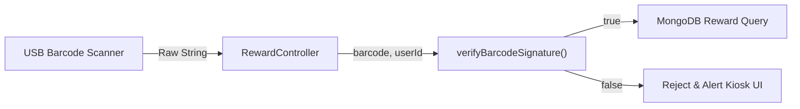

# Function: `verifyBarcodeSignature`

- **Module / File**: `packages/shared/src/utils/crypto.ts`
- **Component**: `Shared Security Subsystem`
- **Author / Agent**: `Antigravity`
- **Date Created**: `2026-11-11`

---

## 1. Why Was This Function Added? (Rationale)
When a customer scans a Code 128 barcode at the vending machine kiosk, the system must immediately verify that the barcode was authentic and created by the SDDS system before querying the database, eliminating unnecessary DB load and preventing counterfeit codes.

## 2. Importance & Criticality
- **System Role**: Security gate for discount redemption.
- **Impact of Failure**: Counterfeit barcodes could be redeemed for discounts, or valid customers rejected.
- **SLA / Performance Requirement**: Sub-millisecond verification with zero timing attack vulnerability.

## 3. Function Signature & Contracts

```typescript
export function verifyBarcodeSignature(barcode: string, userId: string): boolean
```

### Parameters
| Name | Type | Required | Description | Constraints / Validation |
| :--- | :--- | :--- | :--- | :--- |
| `barcode` | `string` | Yes | Scanned Code 128 string from kiosk USB scanner | Format: `SDDS-*-*-*` |
| `userId` | `string` | Yes | Registered user associated with the reward | Non-empty string |

### Return Value
- **Type**: `boolean`
- `true` if HMAC signature matches exactly; `false` otherwise.

---

## 4. Pipeline Integration & Connection

### Upstream Callers & Data Source
- **Trigger**: Customer scans barcode at kiosk checkout.
- **Caller**: `RewardController.scanBarcode()`

### Downstream Targets & Consumers
- **Next Stage**: If `true`, proceeds to `RewardService.findValidReward()` and MongoDB atomic balance query.
- **Failure Target**: If `false`, returns `ValidationError("Invalid or counterfeit barcode")`.

### Integration Flow Diagram


---

## 5. Memory Alignment & Resource Optimization
- Uses fixed-size Node.js Buffers.
- Utilizes `crypto.timingSafeEqual` to prevent timing attacks.
- **Time Complexity**: $O(1)$
- **Space Complexity**: $O(1)$

---

## 6. Security Analysis
- Constant-time memory comparison prevents byte-by-byte timing inference.
- Validates structure and segments strictly before memory allocation.

