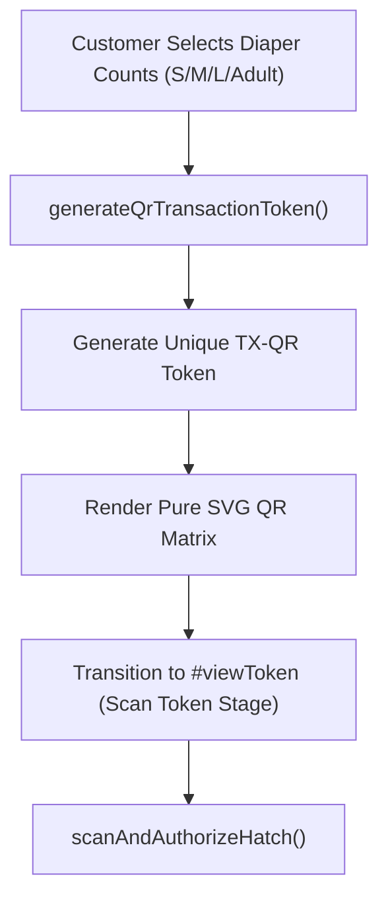

# Function: `generateQrTransactionToken`

- **Module / File**: `packages/bin-frontend/public/bin-kiosk-v5.html`
- **Component**: `Collection Bin Kiosk Subsystem (V5 PRD Baseline)`
- **Author / Agent**: `Antigravity`
- **Date Created**: `2026-11-15`

---

## 1. Why Was This Function Added? (Rationale)
In SDDS V5 (PRD Section 6.4), the QR token is strictly defined as an opaque, unguessable disposal transaction identifier (`TX-QR-XXXX`) that is distinct and separate from any customer reward discount code. It binds the customer's selected diaper sizes and quantities to an authorized disposal intent before the physical chamber latch may be unsealed.

## 2. Importance & Criticality
- **System Role**: Transaction session gatekeeper preventing unauthorized or unmetered opening of the collection hatch.
- **Impact of Failure**: If this fails, the QR token cannot be generated or scanned, blocking customer disposal workflows.

## 3. Function Signature & Contracts

```javascript
function generateQrTransactionToken(): void
```

### Parameters
None. Reads diaper quantities from state `diaperCounts`.

### Return Value
- **Type**: `void`.

### State Mutations & DOM Changes
- Generates `qrTransactionToken = 'TX-QR-' + suffix`.
- Renders the token string in `#lblTokenCode`.
- Draws a pure 25×25 SVG QR matrix using `drawSvgQr()` inside `#tokenQrSvg`.
- Transitions view to `#viewToken`.

---

## 4. Pipeline Integration & Connection

### Upstream Callers & Data Source
- **Trigger**: Customer itemizes diapers in `#viewSelect` and taps *"Generate QR Transaction Token →"*.
- **Caller**: `btnGenerateToken.onclick`, keyboard listener `Enter`.

### Downstream Targets & Consumers
- **Next Stage**: Moves to `#viewToken`, followed by `scanAndAuthorizeHatch()`, which validates the token and unseals the solenoid hatch.

### Integration Flow Diagram


---

## 5. Memory Alignment & Resource Optimization
- Operates on small string identifiers and zero-dependency SVG DOM element injection.
- Zero external QR generation library overhead.
