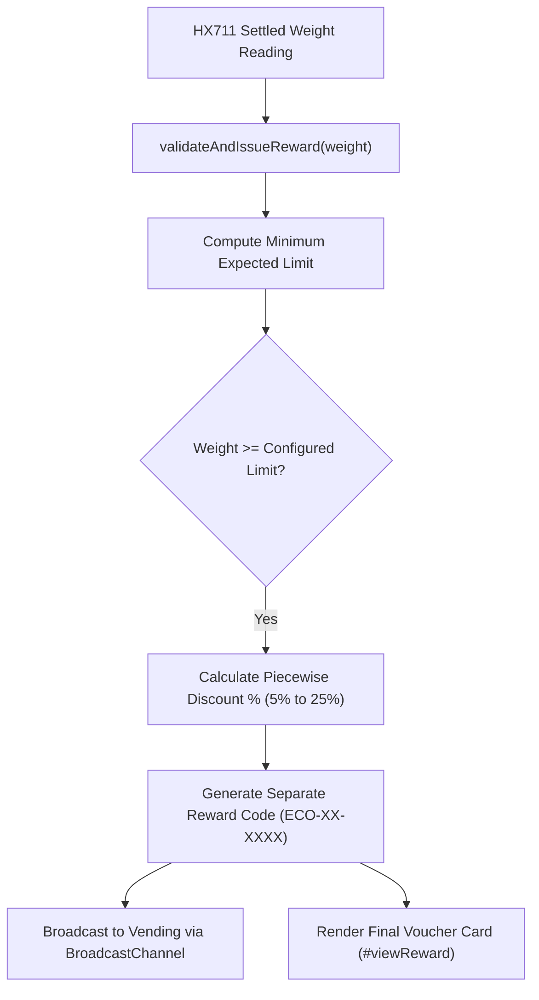

# Function: `validateAndIssueReward`

- **Module / File**: `packages/bin-frontend/public/bin-kiosk-v5.html`
- **Component**: `Collection Bin Kiosk Subsystem (V5 PRD Baseline)`
- **Author / Agent**: `Antigravity`
- **Date Created**: `2026-11-15`

---

## 1. Why Was This Function Added? (Rationale)
Adheres to V5 PRD Section 6.3 (FR-BIN-09, FR-BIN-11, FR-BIN-12). In V5, measuring weight is not merely for calculating a percentage; the system first validates measured load cell weight against configured minimum limits for the selected diaper variants. Only after successful validation does the system issue a separate reward voucher code (`ECO-XX-XXXX`).

## 2. Importance & Criticality
- **System Role**: Core business logic enforcing disposal legitimacy before issuing financial discount vouchers.
- **Impact of Failure**: If validation is bypassed or fails, counterfeit or non-diaper debris could trigger fraudulent rewards.

## 3. Function Signature & Contracts

```javascript
function validateAndIssueReward(weight: number): void
```

### Parameters
| Name | Type | Required | Description | Constraints |
| :--- | :--- | :--- | :--- | :--- |
| `weight` | `number` | Yes | Settled strain gauge measurement in grams | Positive integer $\ge 0$ |

### Return Value
- **Type**: `void`.

### State Mutations & DOM Changes
- Calculates minimum expected threshold based on configured unit limits:
  - Small: $\ge 40\text{g}$
  - Medium: $\ge 60\text{g}$
  - Large: $\ge 85\text{g}$
  - Adult: $\ge 180\text{g}$
- Evaluates piecewise discount formula capped at $25\%$.
- Generates separate `generatedRewardCode = 'ECO-' + discount + '-' + suffix`.
- Renders voucher card with pure SVG QR code in `#viewReward`.
- Dispatches `VOUCHER_ISSUED` event to `BroadcastChannel` and `/api/v1/bin/disposal`.

---

## 4. Pipeline Integration & Connection

### Upstream Callers & Data Source
- **Trigger**: Load cell reading stabilizes in `sealAndValidateWeight()`.
- **Caller**: `sealAndValidateWeight()` timer callback.

### Downstream Targets & Consumers
- **Next Stage**: Renders `#viewReward`, broadcasts code to Vending Machine kiosk, and triggers `finalizeSessionAndReset()` on completion.

### Integration Flow Diagram


---

## 5. Memory Alignment & Resource Optimization
- Single-pass arithmetic limit checks without dynamic allocations.
- Reuses shared BroadcastChannel instance.
