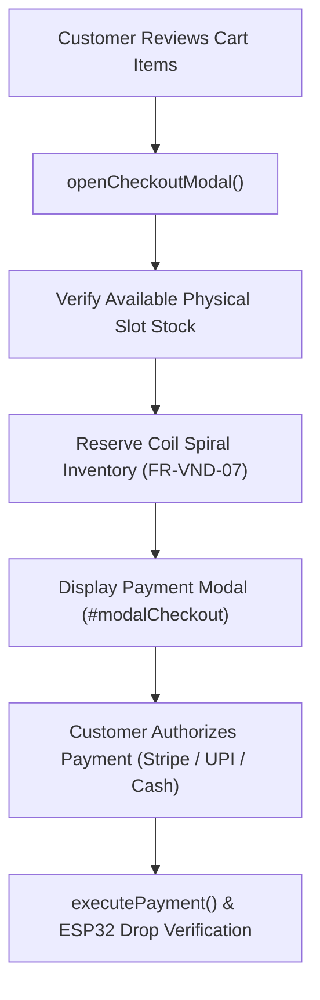

# Function: `openCheckoutModal` / Stock Reservation

- **Module / File**: `packages/vending-frontend/public/kiosk-v5.html`
- **Component**: `Vending Machine Kiosk Subsystem (V5 PRD Baseline)`
- **Author / Agent**: `Antigravity`
- **Date Created**: `2026-11-15`

---

## 1. Why Was This Function Added? (Rationale)
Adheres to V5 PRD Section 6.7 (FR-VND-07). In V5, stock must be explicitly reserved prior to accepting customer payment. If stock is not reserved, race conditions in multi-terminal deployments could lead to customer card charges when physical spiral inventory has already been depleted.

## 2. Importance & Criticality
- **System Role**: Transaction integrity safeguard preventing payment capture on out-of-stock items.
- **Impact of Failure**: Customer could be charged for items that cannot be physically dispensed.

## 3. Function Signature & Contracts

```javascript
function openCheckoutModal(): void
```

### Parameters
None. Reads active cart line items from `cart`.

### Return Value
- **Type**: `void`.

### State Mutations & DOM Changes
- Validates active cart items and quantities against available slot inventory.
- Locks reservation in temporary session memory.
- Updates payable display `#modalPayAmount`.
- Displays modal `#modalCheckout` presenting supported payment gateways (Stripe Card, UPI QR, Cash).

---

## 4. Pipeline Integration & Connection

### Upstream Callers & Data Source
- **Trigger**: Customer taps *"Reserve Stock & Checkout →"* on the cart drawer.
- **Caller**: `btnCheckout.onclick`.

### Downstream Targets & Consumers
- **Next Stage**: Routes to `executePayment(method)`, followed by physical ESP32 dispensing and confirmed IR drop sensor evidence.

### Integration Flow Diagram


---

## 5. Memory Alignment & Resource Optimization
- Operates on immutable state references without expensive deep object cloning.
- Zero memory leakage during modal display toggles.
