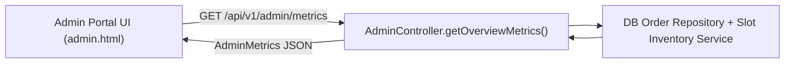

# Function: `AdminController.getOverviewMetrics`

- **Module / File**: `packages/vending-backend/src/controllers/admin.controller.ts`
- **Component**: `Vending Machine Backend — Admin & Telemetry Hub`
- **Author / Agent**: `Antigravity`
- **Date Created**: `2026-11-11`

---

## 1. Why Was This Function Added? (Rationale)
Fulfills Phase 6 of PRD `vendingmachine_V1.md`. Technicians and facility managers require real-time visibility into machine sales, inventory stock levels, drop sensor verification ratios, and ESP32 hardware health without querying the database manually.

---

## 2. Importance & Criticality
- **System Role**: Core KPI Aggregator for Machine Operations.
- **Impact of Failure**: If this endpoint fails, the Admin Portal dashboard displays stale metrics or enters an error state, preventing proactive restocking.
- **SLA / Performance Requirement**: Response time $< 100$ ms.

---

## 3. Function Signature & Contracts

```typescript
export async function getOverviewMetrics(
  req: Request,
  res: Response,
  next: NextFunction
): Promise<void>
```

### Parameters
| Name | Type | Description |
| :--- | :--- | :--- |
| `req` | `Request` | HTTP GET request; expects `X-Admin-PIN` or authorized session. |
| `res` | `Response` | Express response delivering `AdminMetrics` JSON payload. |

### Return Value
JSON response with schema conforming to `AdminMetrics`:
- `grossSalesTodayInr`: `number`
- `ordersCountToday`: `number`
- `totalPacksDispensed`: `number`
- `overallStockHealthPct`: `number`
- `telemetry`: `MachineTelemetry` object

---

## 4. Pipeline Integration & Connection



