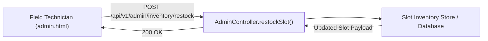

# Function: `AdminController.restockSlot`

- **Module / File**: `packages/vending-backend/src/controllers/admin.controller.ts`
- **Component**: `Vending Machine Backend — Admin & Telemetry Hub`
- **Author / Agent**: `Antigravity`
- **Date Created**: `2026-11-11`

---

## 1. Why Was This Function Added? (Rationale)
When field technicians reload diaper packs into mechanical coils (Slots A1 through B4), the digital inventory matrix in the database must be updated to reflect current physical stock, prevent out-of-stock vending rejections, and recalibrate low-stock warnings.

---

## 2. Importance & Criticality
- **System Role**: Inventory Synchronization & Stock Re-arming.
- **Impact of Failure**: Inventory under-counting leads to premature "Out of Stock" badges on the kiosk, resulting in lost sales. Over-counting causes motor spins on empty coils.
- **SLA / Performance Requirement**: Atomic update $< 50$ ms.

---

## 3. Function Signature & Contracts

```typescript
export async function restockSlot(
  req: Request,
  res: Response,
  next: NextFunction
): Promise<void>
```

### Parameters
| Name | Type | Description |
| :--- | :--- | :--- |
| `req.body.slotId` | `string` | Slot identifier (e.g. `SLOT_A1`) |
| `req.body.quantityAdded` | `number` | Number of diaper packs loaded |

---

## 4. Pipeline Integration & Connection



