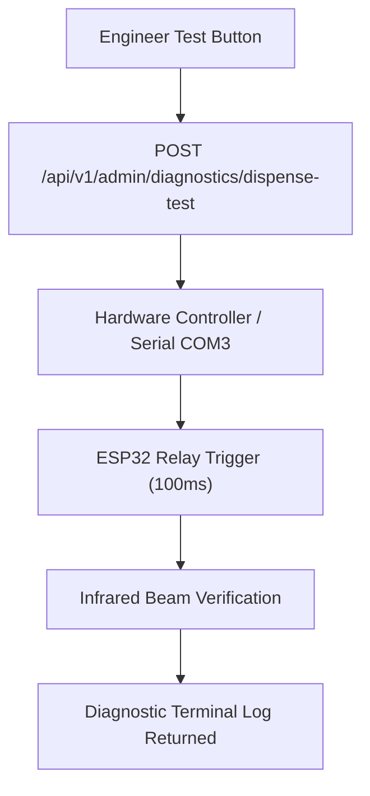

# Function: `AdminController.triggerDiagnosticDispense`

- **Module / File**: `packages/vending-backend/src/controllers/admin.controller.ts`
- **Component**: `Vending Machine Backend — Admin & Telemetry Hub`
- **Author / Agent**: `Antigravity`
- **Date Created**: `2026-11-11`

---

## 1. Why Was This Function Added? (Rationale)
Provides maintenance engineers with a zero-cost, safe motor diagnostic pulse (100ms test spin) to verify spiral rotation, gear lubrication, and infrared drop-sensor baseline without deducting balance, charging cards, or requiring customer checkout.

---

## 2. Importance & Criticality
- **System Role**: Hardware Maintenance & Diagnostic Actuation.
- **Impact of Failure**: Technicians would have to run test customer orders and fake payments to check if a motor channel is jammed.
- **SLA / Performance Requirement**: Actuation response within 200 ms.

---

## 3. Function Signature & Contracts

```typescript
export async function triggerDiagnosticDispense(
  req: Request,
  res: Response,
  next: NextFunction
): Promise<void>
```

### Parameters
| Name | Type | Description |
| :--- | :--- | :--- |
| `req.body.slotId` | `string` | Target motor slot (e.g. `SLOT_A1` to `SLOT_B4`) |
| `req.body.pulseMs` | `number` | Duration of motor pulse (default 100ms) |

---

## 4. Pipeline Integration & Connection



