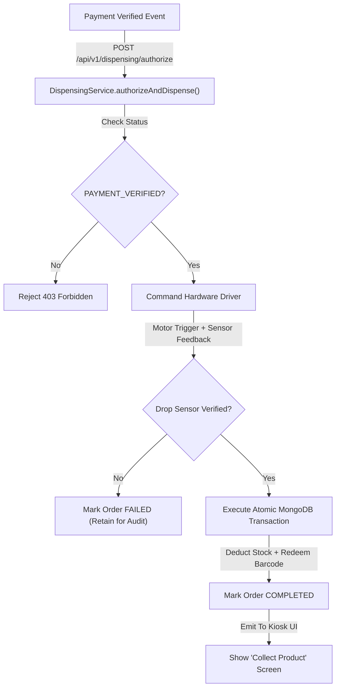

# Function: `DispensingService.authorizeAndDispense`

- **Module / File**: `packages/vending-backend/src/services/dispensing.service.ts`
- **Component**: `Vending Machine Dispensing Orchestrator`
- **Author / Agent**: `Antigravity`
- **Date Created**: `2026-11-11`

---

## 1. Why Was This Function Added? (Rationale)
Coordinating motor actuation with drop sensor confirmation, atomic inventory reduction, and one-time reward redemption requires strict transaction guarantees. This function ensures items are only dispensed when payment is verified, and database states update only when hardware confirms drop delivery.

## 2. Importance & Criticality
- **System Role**: Core physical fulfillment gate of the vending machine.
- **Impact of Failure**: Either physical product dispensed without stock deduction (loss), or money taken without item delivery (customer harm).

## 3. Function Signature & Contracts

```typescript
public async authorizeAndDispense(
  orderId: string
): Promise<{ order: Order; results: DispenseResult[] }>
```

### Parameters
| Name | Type | Required | Description | Constraints / Validation |
| :--- | :--- | :--- | :--- | :--- |
| `orderId` | `string` | Yes | Identifier of order awaiting dispensing | Must be in `PAYMENT_VERIFIED` state |

### Return Value
- **Type**: `Promise<{ order: Order; results: DispenseResult[] }>` with status `COMPLETED`.

### Thrown Exceptions
- `AppError` (`UNAUTHORIZED`): If order status is not `PAYMENT_VERIFIED`.
- `AppError` (`HARDWARE_TIMEOUT`): If motor fails or drop sensor does not detect product fall.

---

## 4. Pipeline Integration & Connection

### Upstream Callers & Data Source
- **Trigger**: Payment verification API response or kiosk confirmation trigger.
- **Caller**: `POST /api/v1/dispensing/authorize` $\rightarrow$ `DispensingController`

### Downstream Targets & Consumers
- **Next Stage**: Motor actuation via `IHardwareDriver.dispense()`, followed by atomic MongoDB transaction across `inventory`, `rewards`, and `orders`.

### Integration Flow Diagram


---

## 5. Memory Alignment & Resource Optimization
- Sequentially processes items, freeing intermediate command buffers.
- Guarantees transaction session release in `DatabaseManager.withTransaction()`.
- **Time Complexity**: $O(K)$ where $K$ is number of items to dispense.
- **Space Complexity**: $O(1)$.

