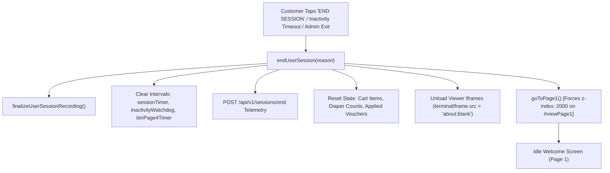

# Function Documentation: `endUserSession`

## 1. Why Added
Provides a bulletproof, non-failing session termination protocol for the public touchscreen kiosk. When a customer taps "END SESSION" (or an inactivity timeout / administrative exit fires), the terminal must cleanly finalize ongoing video recordings, compute interaction duration, reset customer state variables (quantities, cart items, applied vouchers), unload embedded iframe viewers, and unconditionally return to Page 1 (`viewPage1`).

Prior implementations suffered from potential unhandled exceptions if undefined variables or DOM elements were encountered midway, causing the kiosk to become unresponsive or trapped on sub-screens.

## 2. Importance & Criticality
- **Privacy & Security**: Ensures customer data, active carts, and temporary tokens are completely wiped when a customer walks away or terminates a session.
- **Fail-Safe Kiosk Navigation**: Wraps every teardown step in independent error boundaries so that even if network telemetry or camera operations encounter issues, navigation to the Page 1 idle welcome screen is 100% guaranteed.
- **Resource Management (Rule 3)**: Unloads embedded iframe views (`about:blank`) to prevent persistent audio, rogue event listeners, or memory leaks across sessions.

## 3. Signature & Contracts
```typescript
function endUserSession(reason?: string): void
```
- **Inputs**:
  - `reason` (*string*, optional, default `'USER_ABORTED'`): Audit tag indicating the termination cause (e.g., `'USER_ABORTED'`, `'TIMEOUT'`, `'TRANSACTION_COMPLETE'`, `'ADMIN_EXIT'`).
- **Outputs**: None (`void`).
- **Errors Thrown**: Zero unhandled exceptions. All internal operations execute within isolated `try/catch` boundaries with safe fallbacks.

## 4. Behavior & Logic
1. **Recording Finalization**: Calls `finalizeUserSessionRecording(reason)` to close the session's optical video segment.
2. **Timer Teardown**: Clears and nullifies `sessionTimerInterval`, `sessionInactivityTimer`, and `binPage4TimerInterval`.
3. **Audit Dispatch**: Computes elapsed duration in seconds and dispatches an asynchronous audit log to `/api/v1/sessions/end`.
4. **Camera & HUD Revert**: Resets camera status dot, removes recording class, hides session timer, and hides floating HUD buttons.
5. **State Reset**:
   - Zeroes `vendingState` and `binState` counters across sizes S, M, L, XL, Adult.
   - Clears `neonCartItems`, `window.binDepositVoucherPercent`, `window.binDepositVoucherCode`.
   - Clears promo inputs and voucher feedback alerts.
6. **Viewer Teardown**: Resets `terminalIframe.src = 'about:blank'` to release iframe DOM resources.
7. **Modal Cleanup**: Closes settings drawer and success windows cleanly.
8. **Navigation Guarantee**: Invokes `goToPage1()`, which forces `viewPage1` display with `z-index: 2000 !important; display: flex !important;`.

## 5. Pipeline Integration & Flow Mapping


