# Function: `executeRazorpayPayment`

- **Module / File**: `run-all.html` / `index.html`
- **Component**: `Vending Machine Touch Kiosk UI`
- **Author / Agent**: `Antigravity`
- **Date Created**: `2026-11-16`

---

## 1. Why Was This Function Added? (Rationale)
> Orchestrates the complete client-side Razorpay payment flow across both the persistent Cart Drawer and Page 4 Checkout. Initializes order on backend, presents the Razorpay UI, and handles verification.

## 2. Importance & Criticality
- **System Role**: Customer payment interface for UPI, QR, debit/credit cards, and netbanking.
- **Impact of Failure**: Customer cannot complete checkout via Indian payment methods.
- **SLA / Performance Requirement**: Touch-responsive (<100ms response time, 48px+ touch target).

## 3. Function Signature & Contracts

```javascript
async function executeRazorpayPayment(context: 'CART' | 'PAGE4'): Promise<void>
```

### Parameters
| Name | Type | Required | Description | Constraints / Validation |
| :--- | :--- | :--- | :--- | :--- |
| `context` | `string` | No | UI trigger origin ('CART' or 'PAGE4') | Default: 'PAGE4' |

### Return Value
- **Type**: `Promise<void>`

---

## 4. Pipeline Integration & Connection

### Upstream Callers & Data Source
- **Trigger**: Customer taps "Pay with Razorpay (UPI / Card)" button on touchscreen.

### Downstream Targets & Consumers
- **Next Stage**: `POST /api/v1/payments/razorpay/create-order` $\rightarrow$ `Razorpay(options).open()` $\rightarrow$ `POST /api/v1/payments/razorpay/verify` $\rightarrow$ `flushSessionVideoChunk()` $\rightarrow$ `endUserSession('COMPLETED_RAZORPAY')`.

```mermaid
flowchart LR
    A["Customer Taps Razorpay Button"] --> B["executeRazorpayPayment(context)"]
    B --> C["fetch('/api/v1/payments/razorpay/create-order')"]
    C --> D["Razorpay(options).open()"]
    D --> E["Customer Completes UPI / Card Payment"]
    E --> F["fetch('/api/v1/payments/razorpay/verify')"]
    F --> G["flushSessionVideoChunk() & Dispense"]
    G --> H["endUserSession('COMPLETED_RAZORPAY')"]
```


