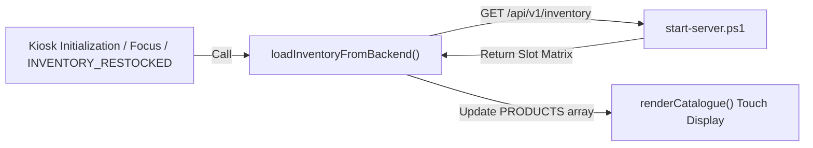

# Function: `loadInventoryFromBackend`

- **Module / File**: `packages/vending-frontend/public/kiosk.html`
- **Component**: `Vending Machine Touchscreen Kiosk UI`
- **Author / Agent**: `Antigravity`
- **Date Created**: `2026-11-14`

---

## 1. Why Was This Function Added? (Rationale)
Ensures the customer-facing kiosk always presents authentic, real-time inventory levels fetched directly from the unified backend state engine rather than stale or hardcoded in-memory counts.

---

## 2. Importance & Criticality
- **System Role**: Customer Catalog & Stock Synchronization.
- **Impact of Failure**: Kiosk might sell an out-of-stock product or fail to display newly replenished channels.
- **SLA / Performance Requirement**: $< 50$ ms round-trip latency.

---

## 3. Function Signature & Contracts

```javascript
async function loadInventoryFromBackend(): Promise<void>
```

### Parameters
None. Fetches `/api/v1/inventory`.

### Behavior & Logic
1. Dispatches asynchronous HTTP GET request to `/api/v1/inventory`.
2. Loops through response `data` slots array.
3. For each slot, updates local `PRODUCTS` array (`stock`, `price`, `name`, `size`).
4. Invokes `renderCatalogue()` to update product cards, stock badges (`In Stock (x)` vs `Out of Stock`), and "Add to Cart" button disabled state.

---

## 4. Pipeline Integration & Connection



