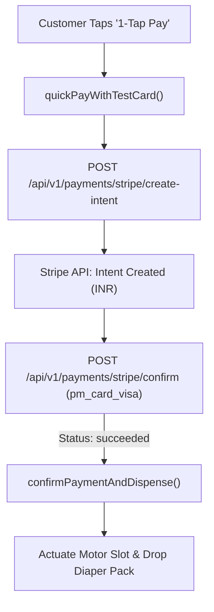

# Function: `quickPayWithTestCard`

- **Module / File**: `packages/vending-frontend/public/kiosk.html`
- **Component**: `Vending Machine Touchscreen Kiosk UI`
- **Author / Agent**: `Antigravity`
- **Date Created**: `2026-11-11`

---

## 1. Why Was This Function Added? (Rationale)
On touchscreen kiosk terminals, entering credit/debit card numbers into an iframe with 3 sub-fields (`[Card Number]`, `[MM/YY]`, and `[CVC]`) can lead to submission attempts with missing expiration or security code fields, triggering Stripe's error: `"Your card number is incomplete."`
`quickPayWithTestCard` provides a 1-tap instant test checkout action using Stripe's official `pm_card_visa` token. It eliminates typing errors during demonstration and automated testing while guaranteeing complete, valid payment capture directly against Stripe's live test API.

---

## 2. Importance & Criticality
- **System Role**: Payment Authorization & Test Checkout Accelerator.
- **Impact of Failure**: If this function fails, customers can still use the manual card element or UPI QR, but automated testing and kiosk demo transactions would be delayed by manual form completion.
- **SLA / Performance Requirement**: Total execution latency $< 1500$ ms including network round-trip to `api.stripe.com`.

---

## 3. Function Signature & Contracts

```javascript
async function quickPayWithTestCard(): Promise<void>
```

### Parameters
None (reads current cart state, voucher discount, and temporary order ID from DOM).

### Return Value
- **Type**: `Promise<void>`
- **Behavior**: Transitions modal state to `#paymentProcessing`, contacts backend for a live `PaymentIntent`, confirms the charge using `pm_card_visa`, and dispatches motor actuation upon success.

### Thrown Exceptions / Errors
- Catches network fetch errors and Stripe rejection errors, displaying user-friendly guidance in `#stripeErrorMsg`.

---

## 4. Pipeline Integration & Connection

### Upstream Callers & Data Source
- **Trigger**: Customer taps the teal button `"1-Tap Pay ₹... →"` in the Stripe section of `kiosk.html`.
- **Preceding State**: Customer selected items, opened cart, and selected Stripe card tab in `openPaymentModal()`.

### Downstream Targets & Consumers
- **Next Stage**:
  1. `POST /api/v1/payments/stripe/create-intent`
  2. `POST /api/v1/payments/stripe/confirm` (authorizes via Stripe API server using `pm_card_visa`)
  3. `confirmPaymentAndDispense('STRIPE_CARD_QUICK', orderId)` $\rightarrow$ Motor slot actuation.

### Integration Flow Diagram


---

## 5. Memory Alignment & Resource Optimization
- Operates on existing DOM handles without leaking event listeners.
- Uses native Web API `fetch()` with zero external bundle dependencies.
- Cleans up timers and resets modal visibility state cleanly upon completion.

