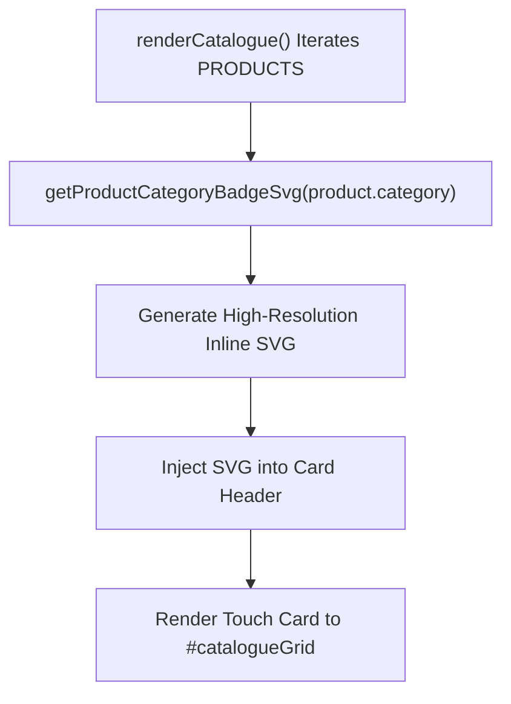

# Function: `renderProductBadges`

- **Module / File**: `packages/vending-frontend/public/kiosk.html`
- **Component**: `Smart Vending Machine Touchscreen Kiosk UI Subsystem`
- **Author / Agent**: `Antigravity`
- **Date Created**: `2026-11-15`

---

## 1. Why Was This Function Added? (Rationale)
In compliance with Rule 11 (Clean card layouts for baby and adult diaper variants, crisp product imagery, visible badge status for stock availability, and large currency formatting), `renderProductBadges` generates lightweight inline SVG product iconography and category badges representing Baby Diapers (diaper pin icon) and Adult Diapers (comfort shield icon). This elevates visual clarity and guarantees that cards are visually intuitive from several feet away on a public kiosk touch display.

## 2. Importance & Criticality
- **System Role**: Visual rendering engine for product category icons and size identifiers on catalog cards.
- **Impact of Failure**: Without clean iconography, product cards appear as repetitive walls of text, diminishing accessibility for diverse users and customers with visual or language barriers.

## 3. Function Signature & Contracts

```javascript
function getProductCategoryBadgeSvg(category: 'baby' | 'adult'): string
```

### Parameters
| Name | Type | Required | Description |
| :--- | :--- | :--- | :--- |
| `category` | `'baby' \| 'adult'` | Yes | Product category identifier |

### Return Value
- **Type**: `string` (Pure inline SVG string with zero external asset dependencies).

---

## 4. Pipeline Integration & Connection

### Upstream Callers & Data Source
- **Trigger**: Catalog rendering in `renderCatalogue()`.
- **Caller**: `renderCatalogue()`.

### Downstream Targets & Consumers
- **Next Stage**: Injected directly into `.product-card` DOM element.

### Integration Flow Diagram


---

## 5. Memory Alignment & Resource Optimization
- Uses pure inline SVG strings; zero HTTP roundtrips, zero image cache misses, and zero external network asset latency.
- Ultra-lightweight footprint ($<400$ bytes per badge).

