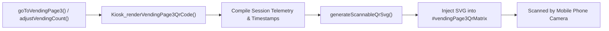

# Function: `Kiosk_renderVendingPage3QrCode`

## 1. Why Added
Provides real-time transparency for customers and auditors by rendering a dynamic, scannable QR Code directly on Vending Page 3 (Diaper Size Selection screen) and Page 4. When scanned with any mobile camera, it exposes real-time session telemetry including session ID, start-to-current timestamps, elapsed session duration, selected diaper quantities, and camera surveillance status.

## 2. Importance & Criticality
Validates that the session is actively timed and audited by the camera surveillance system. Customers can scan the screen at any point during selection to independently confirm order integrity and machine telemetry on their personal smartphones.

## 3. Signature & Contracts
```typescript
function renderVendingPage3QrCode(): void
```
- **Inputs**: None (reads `currentSessionId`, `sessionStartTime`, `vendingState`, and diaper prices).
- **Outputs**: `void` (injects SVG QR matrix into `#vendingPage3QrMatrix`).

## 4. Behavior & Logic
1. Reads `currentSessionId` (fallback to current timestamp ID if idle).
2. Calculates elapsed time from `sessionStartTime`.
3. Compiles itemized counts (Small, Medium, Large, XL, Adult) and subtotal payable.
4. Generates scannable text payload:
   ```
   SDDS VENDING SESSION TELEMETRY
   Session ID: SESS-XXXX
   Start Time: 2026-11-16 12:10:00 UTC
   Current Time: 2026-11-16 12:11:15 UTC
   Elapsed Duration: 75s
   Items: S:1, M:2, L:0, XL:1, Adult:0
   Payable: ₹95
   Camera Surveillance: ACTIVE (Realtek 30fps)
   ```
5. Feeds payload to `generateScannableQrSvg(payload, 110)`.
6. Inserts generated SVG directly into `#vendingPage3QrMatrix`.

## 5. Pipeline Integration & Mapping

