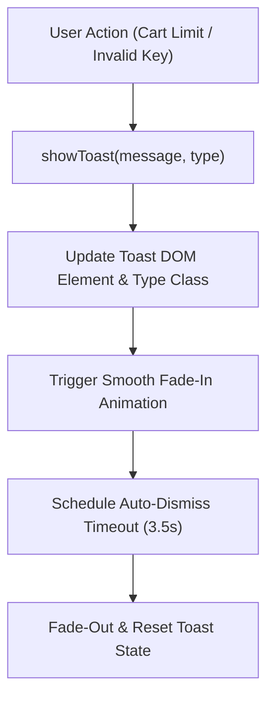

# Function: `showToast`

- **Module / File**: `packages/vending-frontend/public/kiosk.html`
- **Component**: `Smart Vending Machine Touchscreen Kiosk UI Subsystem`
- **Author / Agent**: `Antigravity`
- **Date Created**: `2026-11-15`

---

## 1. Why Was This Function Added? (Rationale)
Previously, the vending machine frontend invoked blocking browser `alert()` dialogs when inventory limits were reached or when configuration inputs failed validation. Native browser `alert()` breaks fullscreen kiosk isolation, halts background rendering, and can freeze or be suppressed inside multi-iframe test simulators (`run-all.html`). `showToast` provides a non-blocking, touch-optimized visual notification overlay with auto-dismissal.

## 2. Importance & Criticality
- **System Role**: Visual user feedback for transient notifications, validation messages, and inventory alerts.
- **Impact of Failure**: If alerts are used instead, users on embedded touchscreen displays or iframes may experience modal lockups or suppressed notifications, leading to abandoned transactions.

## 3. Function Signature & Contracts

```javascript
function showToast(message: string, type: 'info' | 'success' | 'warning' | 'error' = 'info', durationMs: number = 3500): void
```

### Parameters
| Name | Type | Required | Description |
| :--- | :--- | :--- | :--- |
| `message` | `string` | Yes | Human-readable notification text displayed to the kiosk user |
| `type` | `'info' \| 'success' \| 'warning' \| 'error'` | No | Visual status style (colors border & background) |
| `durationMs` | `number` | No | Auto-dismiss countdown in milliseconds (default 3500ms) |

### Return Value
- **Type**: `void`.

### DOM Target
- `#kioskToast`: Sets text, applies styling classes, and toggles display with CSS transition.

---

## 4. Pipeline Integration & Connection

### Upstream Callers & Data Source
- **Trigger**: User exceeds item slot stock in `addToCart()`, enters an invalid custom publishable key in `saveCustomPublishableKey()`, or copies a test card number.
- **Caller**: `addToCart()`, `saveCustomPublishableKey()`, `copyTestCard()`.

### Downstream Targets & Consumers
- **Next Stage**: Displays floating notification banner on screen, auto-clearing via `setTimeout` after `durationMs`.

### Integration Flow Diagram


---

## 5. Memory Alignment & Resource Optimization
- Reuses a single persistent `#kioskToast` DOM element; creates zero memory garbage.
- Clears active timeouts prior to scheduling new ones, preventing timer leaks.

