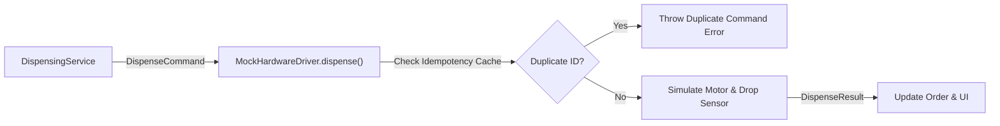

# Function: `MockHardwareDriver.dispense`

- **Module / File**: `packages/vending-backend/src/hardware/esp32-driver.ts`
- **Component**: `Vending Hardware Abstraction Layer`
- **Author / Agent**: `Antigravity`
- **Date Created**: `2026-11-11`

---

## 1. Why Was This Function Added? (Rationale)
Provides an idempotent, simulated hardware driver for automated testing, local development, and CI environments without requiring physical ESP32 wiring or mechanical motor bays attached.

## 2. Importance & Criticality
- **System Role**: Enables full end-to-end integration testing and frontend verification in absence of physical hardware.
- **Impact of Failure**: Developer cannot simulate purchase and dispensing cycle.

## 3. Function Signature & Contracts

```typescript
public async dispense(command: DispenseCommand): Promise<DispenseResult>
```

### Parameters
| Name | Type | Required | Description | Constraints / Validation |
| :--- | :--- | :--- | :--- | :--- |
| `command` | `DispenseCommand` | Yes | Signed command containing `commandId`, `slotId`, `quantity` | Unique `commandId` |

### Return Value
- **Type**: `Promise<DispenseResult>` with `status: 'SUCCESS'` and `sensorConfirmed: true`.

### Thrown Exceptions
- `HardwareError`: Thrown if `commandId` is repeated (idempotency enforcement).

---

## 4. Pipeline Integration & Connection

### Upstream Callers & Data Source
- **Caller**: `DispensingService.executeDispensing()`

### Downstream Targets & Consumers
- **Next Stage**: Result returned to `DispensingController` and emitted to Kiosk UI.

### Integration Flow Diagram


---

## 5. Memory Alignment & Resource Optimization
- Maintains an in-memory `Set<string>` of executed command IDs.
- Releases set in `close()`.
- **Time Complexity**: $O(1)$ set lookup.
- **Space Complexity**: $O(M)$ where $M$ is active command count.

