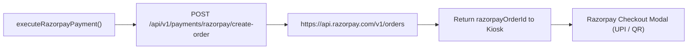

# Function: `RazorpayService_createOrder`

- **Module / File**: `start-server.ps1` (Route: `POST /api/v1/payments/razorpay/create-order`)
- **Component**: `Vending Machine Payment Gateway Backend`
- **Author / Agent**: `Antigravity`
- **Date Created**: `2026-11-16`

---

## 1. Why Was This Function Added? (Rationale)
> Handles Indian payment processing via Razorpay (UPI, QR, Cards, NetBanking). Generates authentic server-side orders via Razorpay REST API with Basic Auth using keys configured in `.env` (`RAZORPAY_KEY_ID`).

## 2. Importance & Criticality
- **System Role**: Core financial order initialization and transaction binding.
- **Impact of Failure**: Customer cannot initiate Razorpay checkout; orders cannot be processed.
- **SLA / Performance Requirement**: <500ms network round-trip.

## 3. Function Signature & Contracts

```typescript
export async function createRazorpayOrder(
  orderId: string,
  amountInr: number
): Promise<{
  success: boolean;
  keyId: string;
  orderId: string;
  razorpayOrderId: string;
  amount: number;
  currency: string;
  status: string;
}>
```

### Parameters
| Name | Type | Required | Description | Constraints / Validation |
| :--- | :--- | :--- | :--- | :--- |
| `orderId` | `string` | Yes | Kiosk order identifier | Non-empty, sanitized |
| `amountInr` | `number` | Yes | Payable amount in INR | Positive number |

### Return Value
- **Type**: `Object` containing `razorpayOrderId`, `keyId`, `amount` in Paise, and `status`.

---

## 4. Pipeline Integration & Connection

### Upstream Callers & Data Source
- **Trigger**: HTTP POST request from `executeRazorpayPayment()` on kiosk frontend.

### Downstream Targets & Consumers
- **Next Stage**: Razorpay API (`https://api.razorpay.com/v1/orders`) $\rightarrow$ Kiosk Frontend Checkout Modal.


