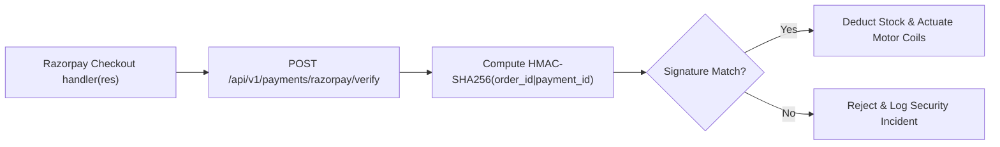

# Function: `RazorpayService_verifySignature`

- **Module / File**: `start-server.ps1` (Route: `POST /api/v1/payments/razorpay/verify`)
- **Component**: `Vending Machine Payment Verification Subsystem`
- **Author / Agent**: `Antigravity`
- **Date Created**: `2026-11-16`

---

## 1. Why Was This Function Added? (Rationale)
> Enforces Rule 8 (Security-First) financial integrity. Cryptographically verifies Razorpay payment completion signatures using `HMAC-SHA256(razorpay_order_id + "|" + razorpay_payment_id, secret)` before dispensing diaper inventory.

## 2. Importance & Criticality
- **System Role**: Anti-tampering, anti-spoofing payment authenticity validation.
- **Impact of Failure**: Unauthorized coil actuation or unpaid inventory release.
- **SLA / Performance Requirement**: Real-time constant-time execution (<5ms).

## 3. Function Signature & Contracts

```typescript
export async function verifyRazorpaySignature(
  orderId: string,
  razorpayOrderId: string,
  razorpayPaymentId: string,
  razorpaySignature: string
): Promise<{ success: boolean; orderId: string; paymentId: string; status: string }>
```

### Parameters
| Name | Type | Required | Description | Constraints / Validation |
| :--- | :--- | :--- | :--- | :--- |
| `orderId` | `string` | Yes | Local kiosk order identifier | Non-empty |
| `razorpayOrderId` | `string` | Yes | Razorpay order ID | Starts with `order_` |
| `razorpayPaymentId` | `string` | Yes | Razorpay payment ID | Starts with `pay_` |
| `razorpaySignature` | `string` | Yes | HMAC-SHA256 hex string | 64 hex characters |

### Return Value
- **Type**: `Object` containing `success: boolean` and payment status.

---

## 4. Pipeline Integration & Connection

### Upstream Callers & Data Source
- **Trigger**: Razorpay Checkout `handler(response)` callback on frontend.

### Downstream Targets & Consumers
- **Next Stage**: Order record creation in `data/sdds-state.json`, inventory decrement, and physical coil motor actuation.


