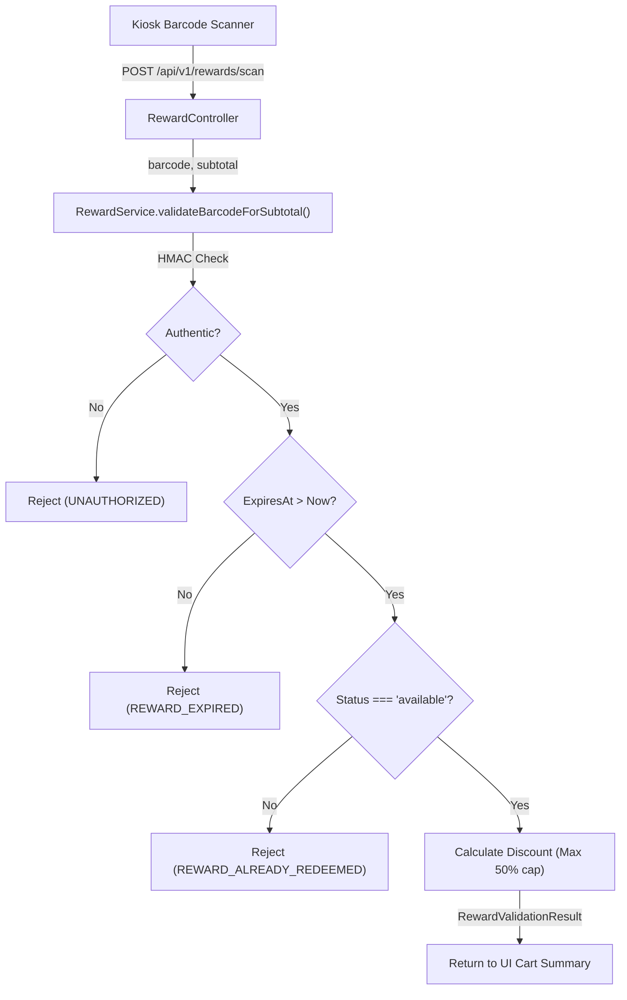

# Function: `RewardService.validateBarcodeForSubtotal`

- **Module / File**: `packages/vending-backend/src/services/reward.service.ts`
- **Component**: `Vending Machine Reward Engine`
- **Author / Agent**: `Antigravity`
- **Date Created**: `2026-11-11`

---

## 1. Why Was This Function Added? (Rationale)
When a customer scans a Code 128 barcode at checkout, the backend must authenticate the barcode, ensure it has not expired under the 7-day rule, verify it hasn't been used before, and compute the safe discount amount without exceeding financial limits.

## 2. Importance & Criticality
- **System Role**: Safeguards monetary value and enforces business rules for reward redemption.
- **Impact of Failure**: Loss of revenue from expired/forged rewards or unfair rejection of valid customers.

## 3. Function Signature & Contracts

```typescript
public async validateBarcodeForSubtotal(
  rawBarcode: string,
  subtotal: number
): Promise<RewardValidationResult>
```

### Parameters
| Name | Type | Required | Description | Constraints / Validation |
| :--- | :--- | :--- | :--- | :--- |
| `rawBarcode` | `string` | Yes | Scanned Code 128 string | Sanitized format: `SDDS-*-*-*` |
| `subtotal` | `number` | Yes | Cart subtotal in ₹ | Must be $> 0$ |

### Return Value
- **Type**: `Promise<RewardValidationResult>`
  - `valid`: `boolean`
  - `barcode`: `string`
  - `rewardPercentage`: `number`
  - `discountAmount`: `number` (in ₹)
  - `expiresAt`: `Date`

### Thrown Exceptions
- `RewardError` (`REWARD_EXPIRED`): If `expiresAt < now`.
- `RewardError` (`REWARD_ALREADY_REDEEMED`): If already marked `redeemed`.
- `RewardError` (`UNAUTHORIZED`): If HMAC signature does not match user identity.

---

## 4. Pipeline Integration & Connection

### Upstream Callers & Data Source
- **Trigger**: USB barcode scan keystroke event or manual scan test on Kiosk UI.
- **Caller**: `POST /api/v1/rewards/scan` $\rightarrow$ `RewardController.scanBarcode()`

### Downstream Targets & Consumers
- **Next Stage**: Frontend updates cart discount display; `OrderService.createOrder()` binds the validated discount to checkout.

### Integration Flow Diagram


---

## 5. Memory Alignment & Resource Optimization
- Single document lookup by primary key `_id: barcode`.
- Constant time calculations, no cursor buffering.
- **Time Complexity**: $O(1)$ indexed lookup.
- **Space Complexity**: $O(1)$.

