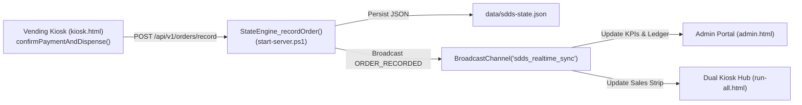

# Function: `StateEngine_recordOrder`

- **Module / File**: `start-server.ps1` (`POST /api/v1/orders/record`)
- **Component**: `SDDS Real-Time Backend State Engine & API Gateway`
- **Author / Agent**: `Antigravity`
- **Date Created**: `2026-11-14`

---

## 1. Why Was This Function Added? (Rationale)
Provides a single source of truth for customer vending orders. Prior to this, `kiosk.html` and `admin.html` ran isolated state stores, causing customer purchases to not deduct slot inventory, not update Gross Sales or Orders Count in the Admin Portal, and not appear in the audit ledger.

---

## 2. Importance & Criticality
- **System Role**: Core Financial & Inventory Reconciliation Engine.
- **Impact of Failure**: Discrepancies between physical slot inventory and kiosk stock; inability for operators to audit real purchases or track revenue.
- **SLA / Performance Requirement**: Execution latency $< 50$ ms; atomic disk persistence to `data/sdds-state.json`.

---

## 3. Function Signature & Contracts

```typescript
export async function recordOrder(
  orderRequest: OrderRecordPayload
): Promise<OrderRecordResponse>
```

### Parameters
| Name | Type | Required | Description | Constraints |
| :--- | :--- | :--- | :--- | :--- |
| `orderId` | `string` | Yes | Unique order identifier (e.g. `ORD-20261114-0092`) | Alphanumeric |
| `items` | `OrderItem[]` | Yes | List of purchased items with `slotId`, `qty`, `price`, `name` | Non-empty array |
| `subtotal` | `number` | Yes | Gross subtotal before discount | Positive number |
| `discountPercentage`| `number` | No | Voucher discount percentage applied | $0 \le x \le 25$ |
| `appliedBarcodeId` | `string` | No | Tamper-proof voucher code (e.g. `ECO-10-SYNC`) | Alphanumeric |
| `finalPayableAmount`| `number` | Yes | Net amount collected from customer | Subtotal minus discount |
| `paymentMethod` | `string` | Yes | `STRIPE_CARD` or `UPI_QR` | Enum |

### Return Value
JSON payload containing:
- `order`: Completed order object for the audit ledger.
- `slots`: Updated array of 8 machine inventory slots with deducted stock.
- `metrics`: Aggregated gross sales, orders count, and packs dispensed.

---

## 4. Pipeline Integration & Connection

### Upstream Callers & Data Source
- **Trigger**: Vending Machine Kiosk customer payment confirmation (`confirmPaymentAndDispense` in `kiosk.html`).
- **Preceding Function**: `processStripePayment()` or `quickPayWithTestCard()`.

### Downstream Targets & Consumers
- **Next Stage**: Updates `data/sdds-state.json` on disk; broadcasts `ORDER_RECORDED` event to `sdds_realtime_sync` channel.
- **Consumers**: Administrator Dashboard (`admin.html`) updates Gross Sales KPI and Orders Ledger; Dual Simulator Hub (`run-all.html`) updates live telemetry strip.

### Integration Flow Diagram


---

## 5. Behavior & Logic
1. Reads active state from memory/disk (`Get-SddsState`).
2. Iterates over order items, finds matching `slotId`, and decrements slot `qty` (clamped to 0).
3. Increments `grossSalesTodayInr` by `finalPayableAmount`.
4. Increments `ordersCountToday` by 1 and `totalPacksDispensed` by total items.
5. Prepends new order object to `state.orders` array.
6. Atomically saves updated state to `data/sdds-state.json`.
7. Returns updated order, slots, and metrics response to caller.

