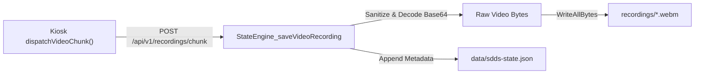

# Function: `StateEngine_saveVideoRecording`

## 1. Why Added
To receive Base64-encoded video chunk payloads on the backend, validate parameters, sanitize filenames against directory traversal (Rule 8), write raw binary bytes to the `recordings/` directory, and log chunk metadata to the unified state file.

## 2. Importance & Criticality
- **Security & Path Traversal (Rule 8)**: Sanitizes input identifiers using strict regex filters, ensuring no malicious paths (`../`, `..\`) can write outside `recordings/`.
- **Durability**: Writes chunks using standard .NET byte streams (`[System.IO.File]::WriteAllBytes`), guaranteeing complete file persistence.

## 3. Signature & Contracts
```powershell
function Handle-SaveVideoChunk($request, $response)
```
- **Inputs**:
  - `request.InputStream`: JSON containing `{ sessionId, chunkIndex, timestamp, dataBase64, mimeType }`.
- **Outputs**:
  - Writes HTTP 200 response with `{ success: true, filename, bytesSaved }`.
- **State Modifications**:
  - Creates a new `.webm` file in `recordings/`.
  - Updates `data/sdds-state.json` recording session chunk index.

## 4. Behavior & Logic
1. Parses JSON body from stream reader.
2. Sanitizes `sessionId` to `[a-zA-Z0-9_\-]`.
3. Ensures `recordings/` directory exists.
4. Converts Base64 data string to raw byte array using `[System.Convert]::FromBase64String()`.
5. Writes file to `recordings/<sessionId>_chunk_<chunkIndex>_<timestamp>.webm`.
6. Appends chunk metadata to `state.videoRecordings`.
7. Saves state and returns success response.

## 5. Pipeline Integration & Connection Mapping
- **Upstream Caller**: Kiosk client `dispatchVideoChunk()` via `POST /api/v1/recordings/chunk`.
- **Downstream Targets**: Local file storage inside `recordings/` and `data/sdds-state.json`.


