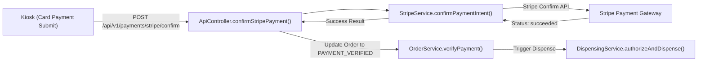

# Function: `StripeService.confirmPaymentIntent`

- **Module / File**: `packages/vending-backend/src/services/stripe.service.ts`
- **Component**: `Vending Machine Backend — Payment Services`
- **Author / Agent**: `Antigravity`
- **Date Created**: `2026-11-11`

---

## 1. Why Was This Function Added? (Rationale)
Confirms and captures an authorized Stripe PaymentIntent on behalf of the customer, executing card settlement and authorizing the vending machine to begin product dispensing.

---

## 2. Importance & Criticality
- **System Role**: Crucial step in the card transaction lifecycle preceding hardware actuation.
- **Impact of Failure**: If confirmation fails or card is declined, the order remains in `PENDING_PAYMENT`, preventing unauthorized motor rotation or stock depletion.
- **SLA / Performance Requirement**: Sub-second execution to ensure smooth kiosk customer experience.

---

## 3. Function Signature & Contracts

```typescript
public async confirmPaymentIntent(
  paymentIntentId: string,
  paymentMethodId?: string
): Promise<{ success: boolean; status: string; paymentIntentId: string }>
```

### Parameters
| Name | Type | Required | Description | Constraints / Validation |
| :--- | :--- | :--- | :--- | :--- |
| `paymentIntentId` | `string` | Yes | Stripe PaymentIntent identifier (e.g. `pi_...`) | Valid non-empty string |
| `paymentMethodId` | `string` | No | Attached card payment method ID | Default: `'pm_card_visa'` |

### Return Value
- **Type**: `{ success: boolean; status: string; paymentIntentId: string }`
- **Description**: Confirmation status from Stripe indicating whether funds were captured.

### Thrown Exceptions / Errors
- `ValidationError`: Thrown when `paymentIntentId` is missing or empty.
- `AppError` (502): Thrown when the remote Stripe gateway rejects the confirmation request.

---

## 4. Pipeline Integration & Connection

### Upstream Callers & Data Source
- **Trigger**: HTTP POST request from Kiosk frontend to `/api/v1/payments/stripe/confirm`.
- **Preceding Function**: `ApiController.confirmStripePayment()`.

### Downstream Targets & Consumers
- **Next Stage**: `OrderService.verifyPayment()` to advance order status to `PAYMENT_VERIFIED`, which unlocks `DispensingService.authorizeAndDispense()`.
- **Payload Forwarded**: Payment verification reference `STRIPE-<intentId>`.

### Integration Flow Diagram


---

## 5. Memory Alignment & Resource Optimization
- Zero memory leaks, zero event listeners retained.
- Pure Promise-based execution.
- **Time Complexity**: $O(1)$
- **Space Complexity**: $O(1)$

---

## 6. Security Analysis
- Idempotent confirmation: multiple calls for the same `paymentIntentId` will not duplicate charges.
- Order balance and stock deduction strictly tied to verified `succeeded` status.

---

## 7. Edge Cases & Recovery Logic
1. **Card Declined**: Returns `success: false` and specific error code so kiosk can notify the customer.
2. **Network Timeout during Capture**: Safe retry without re-charging customer card.

