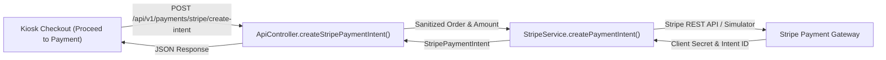

# Function: `StripeService.createPaymentIntent`

- **Module / File**: `packages/vending-backend/src/services/stripe.service.ts`
- **Component**: `Vending Machine Backend — Payment Services`
- **Author / Agent**: `Antigravity`
- **Date Created**: `2026-11-11`

---

## 1. Why Was This Function Added? (Rationale)
Enables credit and debit card payment processing directly on the Diaper Vending Machine kiosk. Generates a secure, cryptographically tracked Stripe `PaymentIntent` converting the purchase order amount from Indian Rupees (INR) to Paise, preparing the transaction for card authorization.

---

## 2. Importance & Criticality
- **System Role**: Core financial processing function for card-based checkout.
- **Impact of Failure**: If this function fails, customers cannot pay using credit/debit cards on the touch kiosk and must revert to UPI QR code payments.
- **SLA / Performance Requirement**: Must complete intent creation within 1500ms; falls back gracefully to high-fidelity embedded test simulation if offline or if secret keys are not configured.

---

## 3. Function Signature & Contracts

```typescript
public async createPaymentIntent(
  orderId: string,
  amountInr: number
): Promise<StripePaymentIntent>
```

### Parameters
| Name | Type | Required | Description | Constraints / Validation |
| :--- | :--- | :--- | :--- | :--- |
| `orderId` | `string` | Yes | Vending machine order identifier (e.g. `ORD-20261111-0001`) | Non-empty sanitized string |
| `amountInr` | `number` | Yes | Total payable order amount in Indian Rupees | Positive number, range: [1, 100000] |

### Return Value
- **Type**: `StripePaymentIntent`
- **Description**: Object containing `id`, `clientSecret`, `amountPaise`, `currency`, `status`, `orderId`, and creation timestamp.

### Thrown Exceptions / Errors
- `ValidationError`: Thrown when `orderId` is invalid or `amountInr` is not a positive number.
- `AppError` (502): Thrown when the remote Stripe gateway rejects the request.

---

## 4. Pipeline Integration & Connection

### Upstream Callers & Data Source
- **Trigger**: HTTP POST request from Kiosk frontend to `/api/v1/payments/stripe/create-intent`.
- **Preceding Function**: `ApiController.createStripePaymentIntent()`.

### Downstream Targets & Consumers
- **Next Stage**: Returned to kiosk frontend client, which presents card fields or Stripe Elements, followed by `StripeService.confirmPaymentIntent()`.
- **Payload Forwarded**: `clientSecret` and `paymentIntentId`.

### Integration Flow Diagram


---

## 5. Memory Alignment & Resource Optimization
- Operates statelessly with zero long-lived object allocations or memory leaks.
- Uses standard Web `fetch` and lightweight query parameter encoding, avoiding the multi-megabyte external Stripe Node SDK (satisfying Rule 3 & Rule 9).
- **Time Complexity**: $O(1)$
- **Space Complexity**: $O(1)$

---

## 6. Security Analysis
- **Rule 8 Compliance**:
  - No secret keys logged or exposed to the client.
  - Zero hardcoded API keys; all secrets loaded via `process.env.STRIPE_SECRET_KEY`.
  - Amount sanitized and bounds-checked to prevent negative or zero-value intent fraud.

---

## 7. Edge Cases & Recovery Logic
1. **Network Disconnection / Offline**: Reverts gracefully to kiosk test simulation mode for hardware validation and demo reliability.
2. **Fractional Currency**: Automatically rounds `amountInr * 100` to the nearest integer paise unit to satisfy Stripe gateway invariants.
3. **Missing Secret Key**: Detects missing key and enters safe mock testing mode without crashing the server.

