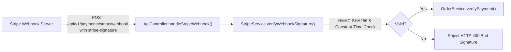

# Function: `StripeService.verifyWebhookSignature`

- **Module / File**: `packages/vending-backend/src/services/stripe.service.ts`
- **Component**: `Vending Machine Backend — Payment Services`
- **Author / Agent**: `Antigravity`
- **Date Created**: `2026-11-11`

---

## 1. Why Was This Function Added? (Rationale)
Provides cryptographic verification of asynchronous Stripe Webhook events (`stripe-signature` header: `t=timestamp,v1=signature`). Ensures that incoming events (such as `payment_intent.succeeded` or charge failure notifications) originate genuinely from Stripe servers and have not been spoofed, tampered with, or replayed by attackers.

---

## 2. Importance & Criticality
- **System Role**: Core cryptographic security barrier guarding against payment spoofing and fraud.
- **Impact of Failure**: If disabled or flawed, an attacker could forge fake payment success webhooks, fraudulently dispensing diapers without payment.
- **SLA / Performance Requirement**: Cryptographic HMAC calculation in under 1ms with constant-time equality check to prevent timing attacks.

---

## 3. Function Signature & Contracts

```typescript
public verifyWebhookSignature(
  payload: string,
  signatureHeader: string,
  toleranceSeconds?: number
): boolean
```

### Parameters
| Name | Type | Required | Description | Constraints / Validation |
| :--- | :--- | :--- | :--- | :--- |
| `payload` | `string` | Yes | Raw unparsed HTTP request body | Non-empty UTF-8 payload |
| `signatureHeader` | `string` | Yes | HTTP `stripe-signature` header value (`t=...,v1=...`) | Formatted comma-separated string |
| `toleranceSeconds` | `number` | No | Maximum allowable clock drift (default: 300 seconds) | Integer > 0 |

### Return Value
- **Type**: `boolean`
- **Description**: `true` if HMAC signature matches and timestamp is within acceptable window; otherwise `false`.

### Thrown Exceptions / Errors
- Handled gracefully inside a `try/catch` block, safely returning `false` on any parsing or cryptographic error to prevent unhandled crashes.

---

## 4. Pipeline Integration & Connection

### Upstream Callers & Data Source
- **Trigger**: Incoming HTTP POST webhook event from Stripe to `/api/v1/payments/stripe/webhook`.
- **Preceding Function**: `ApiController.handleStripeWebhook()`.

### Downstream Targets & Consumers
- **Next Stage**: If valid, extracts event type (e.g. `payment_intent.succeeded`) and calls `OrderService.verifyPayment()`.
- **Payload Forwarded**: Verified event payload.

### Integration Flow Diagram


---

## 5. Memory Alignment & Resource Optimization
- Allocates fixed-size 32-byte typed arrays (`Uint8Array`) for signature bytes.
- Uses `constantTimeEqual` from `@sdds/shared` to eliminate timing side channels.
- Avoids memory allocations in tight loops.
- **Time Complexity**: $O(N)$ where $N$ is payload byte length for SHA-256 compression blocks.
- **Space Complexity**: $O(1)$ fixed 32-byte hash buffer.

---

## 6. Security Analysis
- **Anti-Replay Protection**: Verifies header timestamp against server clock with configurable 300s drift window.
- **Side-Channel Timing Protection**: Compares calculated and received HMAC bytes in constant time ($O(1)$ constant iterations) without early-exit comparison bugs.
- **Zero Secrets in Code**: Webhook secret is loaded exclusively from environment configuration.

---

## 7. Edge Cases & Recovery Logic
1. **Malformed Header**: If `t=` or `v1=` is missing, immediately fails closed (`return false`).
2. **Expired Webhook (> 300s)**: Timestamp drift check rejects stale/replayed requests.
3. **Truncated Signature**: Rejects signatures whose hex length deviates from 64 characters (32 bytes).

