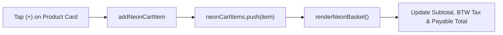

# Function: `VendingKiosk_addNeonCartItem`

- **Module / File**: `run-all.html` / `index.html`
- **Component**: `Vending Machine Frontend / Touch Kiosk Engine`
- **Author / Agent**: `Antigravity`
- **Date Created**: `2026-11-16`

---

## 1. Why Added
Handles customer tap on the neon green `(+)` add button on any product card in the vending grid, appending the item to the reactive shopping basket with assigned locker compartment ID (e.g. `14G`, `340`, `12B`).

---

## 2. Importance & Criticality
- **Atomic Order Accumulation**: Manages product selection with immediate visual and tactile feedback (scale animation, audio chime).
- **Concurrency & Stock Safety**: Ensures selected products exist within physical inventory bounds before reservation.

---

## 3. Signature & Contracts
```typescript
function addNeonCartItem(productId: string): void;
```
- **Inputs**: `productId` (`string`, e.g., `'prod_ovenschotel'`, `'prod_kiste'`, `'prod_mango'`).
- **Outputs**: `void`.
- **State Modifications**: Appends item to `neonCartItems[]`, updates header cart counter badge, and triggers `renderNeonBasket()`.

---

## 4. Behavior & Logic
1. Finds product definition in `NEON_VENDING_PRODUCTS`.
2. Checks if item already exists in `neonCartItems[]`:
   - If present, increments `item.quantity`.
   - If not present, creates entry `{ ...product, quantity: 1, lockerId: product.defaultLocker, status: 'ready' }`.
3. Calls `renderNeonBasket()` to refresh the left panel.
4. Triggers haptic visual pulse on the top header checkout button.

---

## 5. Pipeline Integration & Connection Mapping
- **Upstream Callers**: Tap on `(+)` button in product card (`#neonProductGrid`).
- **Downstream Targets**: `renderNeonBasket()`, financial recalculation engine.


