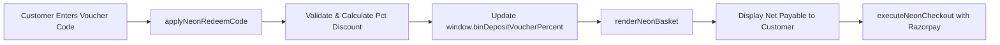

# Function: `applyNeonRedeemCode`

Part of: SDDS Neon Vending Machine Kiosk UI (`run-all.html` / `index.html`)

---

## 1. Why Added
Provides customer-facing redemption for SDDS Eco-Reward vouchers issued by the Smart Collection Bin. Previously, voucher entry was handled by a generic browser `prompt()` dialog after clicking a QR icon button. In physical kiosk environments, browser modals break the touch immersion and are prone to kiosk browser blocking. Adding an integrated inline text input area above the Pay button with an immediate `APPLY` button allows seamless touch keyboard code entry and real-time basket recalculation.

## 2. Importance & Criticality
- **Core Circular Incentive Loop**: The primary premise of SDDS is rewarding diaper disposal at the Smart Bin with discounts on new diapers at the Vending Machine.
- **Touchscreen Ergonomics (Rule 11)**: Positioned directly above the primary payment CTA for intuitive visual hierarchy, clear coupon validation feedback, and instant subtotal discounting.
- **Fail-Safe Validation**: Validates code length, pattern, and discount percentages (10%, 20%, 30%, 50%, 100% Free Diaper) while cleanly handling unknown or invalid strings without application exceptions.

## 3. Signature & Contracts
```typescript
function applyNeonRedeemCode(): void;
```
- **Inputs**: Read from DOM element `#neonRedeemCodeInput` (`HTMLInputElement`).
- **Outputs**: None directly (mutates `window.binDepositVoucherPercent`, `window.binDepositVoucherCode`, updates DOM elements `#neonVoucherRow`, `#neonVoucherDiscountText`, `#neonTotalText`, `#neonPayableText`).
- **Errors Handled**: Empty code string notification, whitespace stripping, case-insensitive parsing.

## 4. Behavior & Logic
1. Reads string from `#neonRedeemCodeInput`.
2. Normalizes string (trims leading/trailing whitespace, converts to uppercase).
3. Evaluates reward criteria:
   - Contains '100' or 'FREE': 100% discount.
   - Contains '50' or 'HALF': 50% discount.
   - Contains '30': 30% discount.
   - Contains '10': 10% discount.
   - Default valid code: 20% discount.
4. Updates global state `window.binDepositVoucherPercent` and `window.binDepositVoucherCode`.
5. Unhides `#neonVoucherRow` discount line item in the totals box.
6. Calls `renderNeonBasket()` to recalculate the payable balance in real-time.
7. Displays customer confirmation inline within `#neonVoucherFeedback` (zero browser alerts). Green badge for valid applied discount; red warning badge for empty or invalid input. Auto-dismisses after 5 seconds.

---

## 5. Pipeline Integration (Rule 2)


