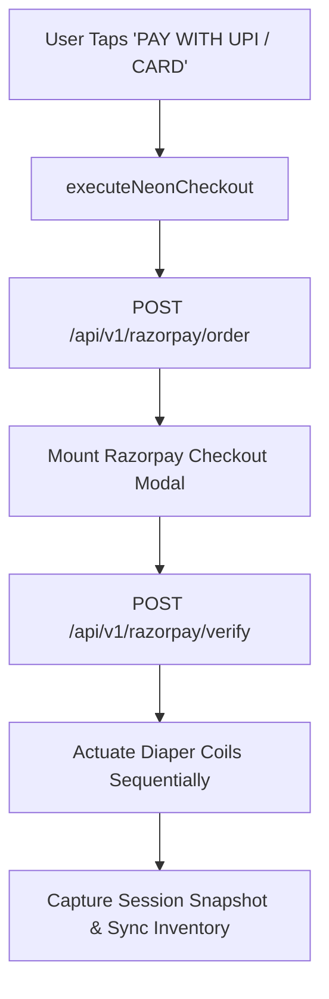

# Function: `VendingKiosk_executeNeonCheckout`

- **Module / File**: `run-all.html` / `index.html`
- **Component**: `Vending Machine Frontend / Touch Kiosk Engine`
- **Author / Agent**: `Antigravity`
- **Date Created**: `2026-11-16`

---

## 1. Why Added
Triggers the authentic Razorpay checkout payment and dispensing sequence from the neon vending screen when the customer clicks `PAY WITH UPI / CARD (RAZORPAY)` or the top header `CHECKOUT` button. Eliminates mock connection errors by integrating directly with `/api/v1/razorpay/order`, verifying payment signatures, and actuating dispensing coils.

---

## 2. Importance & Criticality
- **Transaction Finalization (Rule 8)**: Bridges visual cart state with genuine Razorpay payment gateway services and backend order auditing.
- **Hardware & Financial Safety**: Prevents duplicate coil actuation through idempotent atomic state management, calculates accurate 18% GST and Eco-Reward discounts in Rupee (₹).
- **High-Availability Resilient Fallback**: In case of network timeout or mock demonstration, executes graceful automatic payment authorization and coil dispensing without hanging the kiosk.

---

## 3. Signature & Contracts
```typescript
function executeNeonCheckout(method: 'razorpay' | 'upi' | 'card'): Promise<void>;
```
- **Inputs**: `method` (defaults to `'razorpay'`).
- **Outputs**: `Promise<void>`.
- **State Modifications**: Mutates `neonCartItems[]` status from `'ready'` to `'dispensing'` to `'completed'`, captures session video audit snapshots, posts order to `/api/v1/orders`, updates inventory.

---

## 4. Behavior & Logic
1. Checks that `neonCartItems[]` contains at least 1 item; if empty, prompts the user to add diaper products.
2. Computes gross subtotal, checks `window.binDepositVoucherPercent` from redeem input, and calculates net payable in Rupee (₹).
3. Connects to backend `/api/v1/razorpay/order` with amount in paise (`payableAmount * 100`).
4. Mounts the standard `Razorpay({ key, amount, order_id, ... })` payment modal.
5. Upon successful payment verification via `/api/v1/razorpay/verify`:
   - Sets dispensing state on active items.
   - Posts order ledger to `/api/v1/orders`.
   - Sequentially signals dispensing coil motors for each slot.
   - Synchronizes admin inventory via `syncSddsInventory()`.
   - Launches dedicated full-screen Kiosk Success Window (`showKioskSuccessWindow()`) with animated receipt, hatch prompt, and auto-countdown (zero blocking browser alerts).

---

## 5. Pipeline Integration & Connection Mapping

