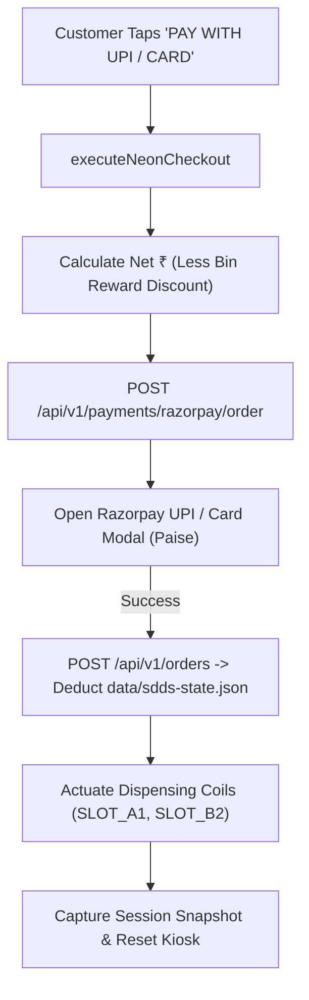

# Function: `VendingKiosk_executeRazorpayRupeeCheckout`

- **Module / File**: `run-all.html` / `index.html`
- **Component**: `Vending Machine Frontend / Payment & Dispensing Engine`
- **Author / Agent**: `Antigravity`
- **Date Created**: `2026-11-16`

---

## 1. Why Added
Executes the customer checkout sequence using Indian Rupees (`₹`) via the Razorpay payment gateway (or test card modal). Upon successful payment authorization, debits slot inventory via `POST /api/v1/orders` and actuates the physical/simulated dispensing coils in sequential order.

---

## 2. Importance & Criticality
- **Financial Security (Rule 8)**: Converts Rupee amounts into integer paise ($1\text{ INR} = 100\text{ paise}$), requests a cryptographically signed Razorpay Order ID from `/api/v1/payments/razorpay/order`, and verifies the HMAC-SHA256 signature before triggering hardware motors.
- **Idempotency**: Prevents duplicate dispensing on network retries.

---

## 3. Signature & Contracts
```typescript
function executeNeonCheckout(method?: 'razorpay' | 'contactless' | 'test_card'): Promise<boolean>;
```
- **Inputs**: `method` (string, optional, defaults to `'razorpay'`).
- **Outputs**: `Promise<boolean>` indicating transaction success.
- **State Modifications**: Updates `neonCartItems` status to `'dispensing'`, triggers locker animations, decrements stock, records transaction, and takes session audit snapshot.

---

## 4. Behavior & Logic
1. Verifies `neonCartItems.length > 0`.
2. Computes financial totals:
   - $Gross = \sum (price \times quantity)$.
   - $Discount = Gross \times (voucherPercent / 100)$.
   - $Net = \max(0, Gross - Discount)$.
3. Initiates Razorpay payment popup or test confirmation for amount $Net$ in ₹.
4. On payment completion:
   - Sets items to `'dispensing'` state with active spinners in the basket.
   - Posts order payload to `/api/v1/orders`:
     `{ items: [...], grossAmount: Gross, discountPercent: voucherPercent, netAmount: Net, paymentMethod: 'RAZORPAY_UPI' }`.
   - Actuates each locker coil sequentially (`SLOT_A1`, `SLOT_A2`, etc.) with 1.2s delay.
   - Marks items as `'ready'` (`✔ Dispensed & Door Open`).
   - Captures optical session audit snapshot `SESSION_DISPENSE_SUCCESS`.
   - Clears cart and prepares automatic session reset.

---

## 5. Pipeline Integration & Connection Mapping
- **Upstream Callers**: Tap on `PAY WITH UPI / CARD (RAZORPAY)` button or header checkout CTA.
- **Downstream Targets**: `POST /api/v1/payments/razorpay/order`, `POST /api/v1/orders`, `captureSessionSnapshot()`.


