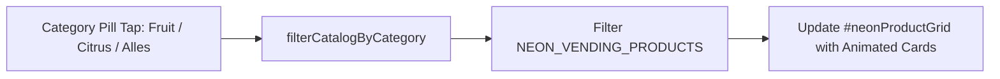

# Function: `VendingKiosk_filterCatalogByCategory`

- **Module / File**: `run-all.html` / `index.html`
- **Component**: `Vending Machine Frontend / Touch Kiosk Engine`
- **Author / Agent**: `Antigravity`
- **Date Created**: `2026-11-16`

---

## 1. Why Added
Enables customers to filter the 12-item catalog on the neon vending screen by product category (e.g., *Alles*, *Citrus*, *Fruit*, *Gesneden groenten & soepen*, *Verspakket*, *Zuivel & Kaas*, *Kant-en-klaar*) using prominent touch-friendly pill buttons matching `screen.png`.

---

## 2. Importance & Criticality
- **Touch Usability (Rule 11)**: Facilitates rapid, clutter-free product discovery on a large public kiosk touch display.
- **Visual Feedback**: Applies the active neon lime styling (`#ccff33` background, `#9ef01a` 2px border, dark text) to the selected category button while rendering unselected categories in neutral slate.

---

## 3. Signature & Contracts
```typescript
function filterCatalogByCategory(categoryKey: string): void;
```
- **Inputs**: `categoryKey` (`string`, e.g., `'all'`, `'citrus'`, `'fruit'`, `'groenten'`, `'verspakket'`, `'zuivel'`, `'kant-en-klaar'`).
- **Outputs**: `void`.
- **State Modifications**: Updates `activeNeonCategory` and re-renders product cards in `#neonProductGrid`.

---

## 4. Behavior & Logic
1. Updates `activeNeonCategory = categoryKey`.
2. Updates UI button classes: sets active glow on the selected category pill and deactivates others.
3. Filters the `NEON_VENDING_PRODUCTS` array where `item.category === categoryKey` (or all if `categoryKey === 'all'`).
4. Updates `#neonProductGrid` with matching product cards.

---

## 5. Pipeline Integration & Connection Mapping
- **Upstream Callers**: Touch click on any category pill button in `#neonCategoryTabs`.
- **Downstream Targets**: DOM update of `#neonProductGrid`.


