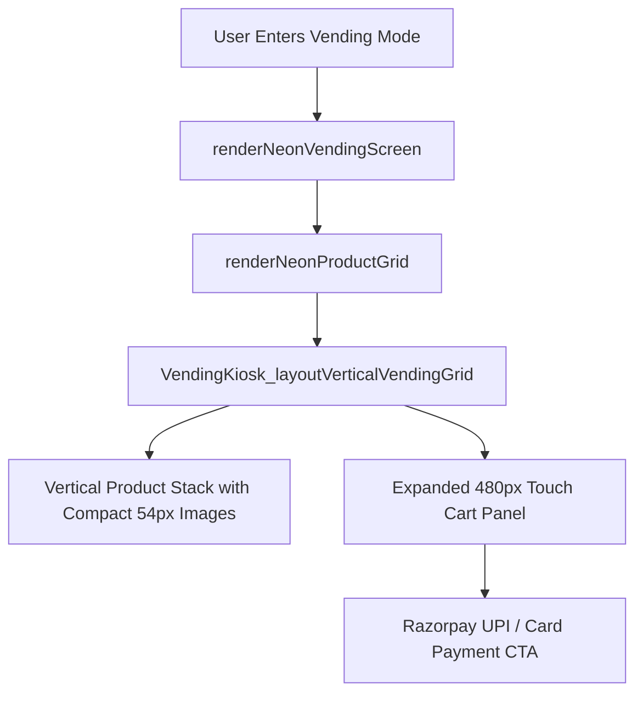

# Function: `VendingKiosk_layoutVerticalVendingGrid`

## 1. Why Added
Addresses customer feedback regarding the vending interface (`viewVendingPage3`):
1. Replaces horizontal scrolling across the catalog and category filters with clean, ergonomic **vertical scrolling** and flex-wrapping with strictly zero horizontal overflow.
2. Drastically **reduces the product card image height** (down to compact 54px containers) and removes redundant description paragraphs (`neon-card-desc`) so that multiple rows of products are visible without clutter.
3. Substantially **expands the cart area** width (to 480px), dedicating more space for itemized lists, 30px touch counters (`+` / `-`), GST breakdowns, Eco-Reward voucher discounts, and the prominent Razorpay payment CTA button.

## 2. Importance & Criticality
In a touch kiosk operating in hospitals, transit hubs, and public malls, customer purchase decisions are influenced by how effortlessly they can browse diaper variants and review their basket:
- Horizontal scrolling on kiosks causes gesture ambiguity (accidental swipes triggering browser navigation). Pure vertical scrolling provides natural single-direction swiping.
- Compact product images and streamlined cards allow customers to view more diaper options simultaneously (e.g. Newborn vs S vs M vs Adult Pull-ups).
- An expanded cart area guarantees touch targets exceed touchscreen accessibility standards (Rule 11) and prevents checkout action crowding.

## 3. Signature & Contracts
```typescript
function VendingKiosk_layoutVerticalVendingGrid(): void
```
- **Inputs**: None (applied through CSS grid definitions and dynamic catalogue rendering).
- **Outputs**: Responsive vertical scroll containers and expanded cart layout.
- **Constraints Satisfied**:
  - Main grid: `grid-template-columns: 30% 1fr;` (reduced cart to exactly 30% width, providing 70% width to catalog).
  - Product card height: `min-height: 200px;` with image container `height: 85px;` (comfortably increased height with fixed column width).
  - Catalogue: `overflow-y: auto !important; overflow-x: hidden !important; flex-wrap: wrap;` (zero horizontal overflow).

## 4. Behavior & Logic
1. Reconfigures `.neon-main-grid` to allocate 480px to `.neon-left-panel` (the cart & checkout container) with `overflow-x: hidden !important;`.
2. Updates `.neon-left-panel` and `.neon-basket-list` with comfortable line-item heights and 30px touch counter controls.
3. Modifies `.neon-category-bar` so category chips wrap naturally (`flex-wrap: wrap;`) without horizontal scrollbars.
4. Redesigns `.neon-card-img-wrap` with a compact 54px height, ensuring diaper pack imagery remains crisp without dominating the card height.
5. Streamlines `.neon-prod-card` by removing redundant description text, focusing solely on product title, locker slot, price, and add-to-cart button.
6. Preserves live inventory synchronization (`syncSddsInventory()`), Razorpay payment flows, and slot dispense telemetry.

## 5. Pipeline Integration (Rule 2)

- **Upstream Callers**: `goToVendingPage3()`, `renderNeonVendingScreen()`, category filter changes.
- **Downstream Targets**: `renderNeonBasket()`, `executeNeonCheckout()`, `addNeonCartItem()`.
