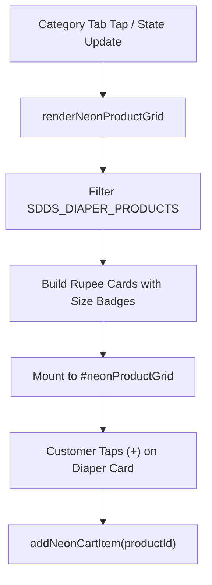

# Function: `VendingKiosk_renderDiaperCatalog`

- **Module / File**: `run-all.html` / `index.html`
- **Component**: `Vending Machine Frontend / Touch Kiosk Engine`
- **Author / Agent**: `Antigravity`
- **Date Created**: `2026-11-16`

---

## 1. Why Added
Renders the 12 authentic SDDS baby and adult diaper products, pull-up pants, eco-bamboo diapers, and bed underpads in the neon grid layout. Replaces all placeholder fresh produce items with genuine diaper visuals, size tags (`S`, `M`, `L`, `XL`, `NB`), pack counts, slot assignments, and Indian Rupee (`₹`) pricing.

---

## 2. Importance & Criticality
- **Customer Usability & Trust (Rule 11)**: Delivers clear, high-contrast imagery, visible brand names (MamyPoko, Pampers, Huggies, Friends, Lifree, KareIn, Bambo Nature, Dignity), and transparent rupee pricing.
- **Touch Accessibility**: Provides large 48px+ touch targets and reactive `(+)` add buttons.

---

## 3. Signature & Contracts
```typescript
function renderNeonProductGrid(): void;
```
- **Inputs**: None (reads `neonActiveCategory` and `SDDS_DIAPER_PRODUCTS`).
- **Outputs**: `void`.
- **State Modifications**: Mounts rendered HTML cards into `#neonProductGrid`.

---

## 4. Behavior & Logic
1. Filters `SDDS_DIAPER_PRODUCTS` based on `neonActiveCategory` (*all*, *baby*, *adult*, *pants*, *eco*, *hygiene*).
2. For each matching product:
   - Formats rupee price: `formatRupee(product.price)`.
   - Generates image container with size badge (e.g. `Size S (10s)`, `Size L (10s)`).
   - Renders product title, absorbency description, and slot tag (`SLOT_A1`, etc.).
   - Renders the neon lime `(+)` add button or "Out of Stock" disabled pill.
3. Injects markup into `#neonProductGrid`.

---

## 5. Pipeline Integration & Connection Mapping
- **Upstream Callers**: `renderNeonVendingScreen()`, `filterCatalogByCategory()`, `syncSddsInventory()`.
- **Downstream Targets**: `addNeonCartItem(productId)`.


