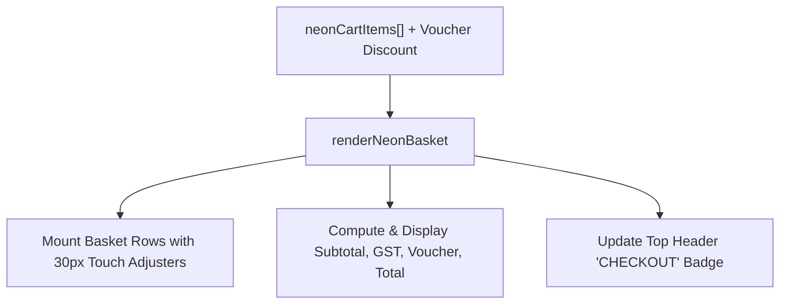

# Function: `VendingKiosk_renderNeonBasket`

- **Module / File**: `run-all.html` / `index.html`
- **Component**: `Vending Machine Frontend / Touch Kiosk Engine`
- **Author / Agent**: `Antigravity`
- **Date Created**: `2026-11-16`

---

## 1. Why Added
Renders the left-side order and dispensing panel on the neon vending screen as depicted in `PICS/stitch_neon_vending_machine_screen/screen.png`. Shows each selected item with locker designation (`14G`, `340`), status indicator (completed check, dispensing spinner, reserved), item count, subtotal, 18% GST tax, eco-voucher discount, total balance due, and touch-optimized quantity adjusters.

---

## 2. Importance & Criticality
- **Touch Ergonomics & Accessibility (Rule 11)**: Large 30px × 30px touch targets for quantity adjustment (`+` / `-`) ensure effortless, reliable operation on kiosk touchscreens.
- **Financial Transparency (Rule 4 & 8)**: Displays exact cost breakdown in Rupee (₹), discount subtractions from collection bin deposits, and remaining balance to pay.
- **Hardware Feedback**: Previews compartment actuation status before and during dispensing.

---

## 3. Signature & Contracts
```typescript
function renderNeonBasket(): void;
```
- **Inputs**: None (reads `neonCartItems[]`, `window.binDepositVoucherPercent`, and session state).
- **Outputs**: `void`.
- **State Modifications**: Updates `#neonBasketList`, `#neonSubtotalText`, `#neonBtwText`, `#neonVoucherRow`, `#neonTotalText`, and `#neonPayableText`.

---

## 4. Behavior & Logic
1. Computes raw subtotal: $\sum (item.price \times item.quantity)$.
2. Computes 18% GST: $subtotal \times 0.18$.
3. Checks for active collection bin reward discount (e.g. 5% - 25% from prior deposit).
4. Computes payable total: $\max(0, subtotal - discountAmount)$.
5. Renders individual item rows in `#neonBasketList` with 30px touch increment/decrement controls, live quantity counter, locker badge, and status indicator.
6. Updates header checkout button with item count and total sum.

---

## 5. Pipeline Integration & Connection Mapping
- **Upstream Callers**: `addNeonCartItem()`, `adjustNeonCartItem()`, `openNeonVoucherModal()`.
- **Downstream Targets**: DOM containers `#neonBasketList`, `#neonTotalsPanel`, `#neonHeaderCheckoutBtn`.


