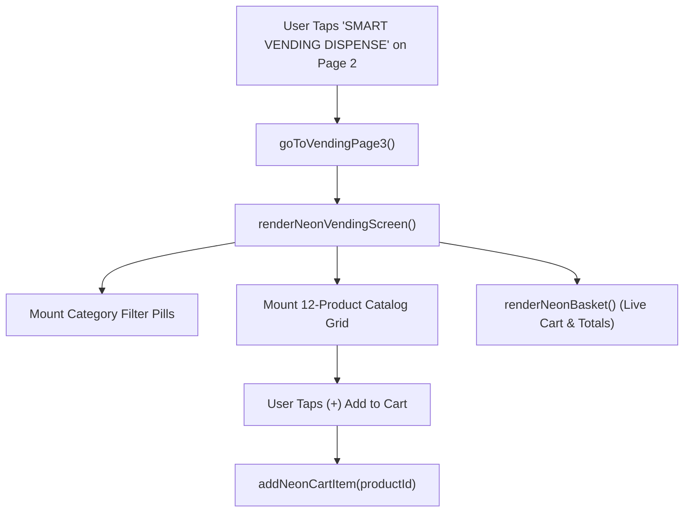

# Function: `VendingKiosk_renderNeonVendingScreen`

- **Module / File**: `run-all.html` / `index.html`
- **Component**: `Vending Machine Frontend / Touch Kiosk Engine`
- **Author / Agent**: `Antigravity`
- **Date Created**: `2026-11-16`

---

## 1. Why Added
To mount and render the unified, high-tech neon lime (`#9ef01a`, `#ccff33`) smart vending machine screen adapted from `PICS/stitch_neon_vending_machine_screen/` (`screen.png` and `code.html`). It replaces the previous multi-step vending pages with an all-in-one touch-optimized interface featuring a live cart/dispensing panel on the left and a 12-item categorized catalog on the right.

---

## 2. Importance & Criticality
- **System Role**: Core customer interaction surface for browsing and purchasing vending products.
- **Hardware Integration**: Reflects real-time compartment availability, cooling temperature (+3.8 °C), and locker dispensing states.
- **Consequences if Failed**: Complete blockage of the vending customer journey.

---

## 3. Signature & Contracts
```typescript
function renderNeonVendingScreen(): void;
```
- **Inputs**: None (reads reactive catalog database and kiosk session state).
- **Outputs**: `void`.
- **State Modifications**: Activates `#viewVendingPage3`, renders category filter pills, mounts product catalog grid, and initializes the cart panel.

---

## 4. Behavior & Logic
1. Hides all other views via `hideAllViews()`.
2. Sets `currentTerminalMode = 'vending_neon'`.
3. Displays `#viewVendingPage3` with two-column responsive layout.
4. Renders the category filter tabs (*Alles*, *Citrus*, *Fruit*, *Gesneden groenten & soepen*, *Verspakket*, *Zuivel & Kaas*, *Kant-en-klaar*).
5. Populates the 12-item product catalog cards with images, badges, descriptions, prices, and `(+)` buttons.
6. Calls `renderNeonBasket()` to synchronize the order panel with current cart selections.

---

## 5. Pipeline Integration & Connection Mapping
- **Upstream Callers**: User taps "SMART VENDING DISPENSE" on Page 2 (`goToVendingPage3()`).
- **Downstream Targets**: `filterCatalogByCategory()`, `addNeonCartItem()`, `renderNeonBasket()`.


