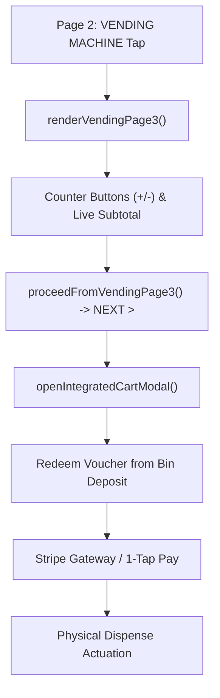

# Function: `VendingKiosk_renderPage3SizeSelector`

- **Module / File**: `run-all.html` / `index.html`
- **Component**: `Vending Machine Frontend / Master Kiosk Host`
- **Author / Agent**: `Antigravity`
- **Date Created**: `2026-11-16` (Updated for Deep Cart Integration)

---

## 1. Why Was This Function Added? (Rationale)
Provides the customer-facing Page 3 size selection interface for the Vending Machine, centered on the kiosk display. Beyond quantity increments, it connects directly into the SDDS shopping cart, live unit pricing (Small ₹25, Medium ₹35, Large ₹45), real-time subtotal computation, bin discount voucher redemption, and checkout execution.

---

## 2. Importance & Criticality
- **System Role**: Core retail intake, cart itemization, and checkout initiator.
- **Impact of Failure**: Customers cannot configure diaper purchases or access checkout.
- **SLA / Performance Requirement**: Instantaneous DOM counter updates (<16ms) with 60fps tactile touch feedback and sub-second checkout modal presentation.

---

## 3. Function Signature & Contracts

```typescript
export function renderVendingPage3(
  initialSelection?: { small: number; medium: number; large: number }
): void
```

### Parameters
| Name | Type | Required | Description | Constraints / Validation |
| :--- | :--- | :--- | :--- | :--- |
| `initialSelection` | `object` | No | Initial product quantities | Each quantity $\in [0, 10]$ |

### Return Value
- **Type**: `void`
- **Description**: Mounts `#viewVendingPage3`, connects counter buttons, updates the live subtotal ticker, and triggers `openIntegratedCartModal()` upon tapping `NEXT >`.

---

## 4. Pipeline Integration & Connection



### Upstream Callers & Data Source
- **Trigger**: Customer taps "VENDING MACHINE" on Page 2 or "Use in Vending Machine" on the collection bin receipt.

### Downstream Targets & Consumers
- **Next Stage**: `openIntegratedCartModal()` renders the itemized order breakdown, applies discounts, verifies payments with the backend, and signals simulated coil motors to dispense.
