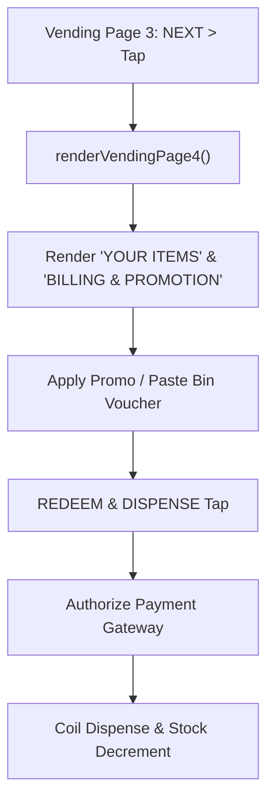

# Function: `VendingKiosk_renderPage4CartCheckout`

- **Module / File**: `run-all.html` / `index.html`
- **Component**: `Vending Machine Frontend / Master Kiosk Host`
- **Author / Agent**: `Antigravity`
- **Date Created**: `2026-11-16`

---

## 1. Why Was This Function Added? (Rationale)
Renders the dedicated Page 4 interface for the Vending Machine as shown in `PICS/vendingpage4.png`. Implements a side-by-side layout containing the interactive shopping cart ("YOUR ITEMS") on the left and the promo code redemption and financial breakdown ("BILLING & PROMOTION") on the right.

---

## 2. Importance & Criticality
- **System Role**: Final review and settlement terminal prior to physical coil motor dispensing.
- **Impact of Failure**: Customers cannot verify items, apply discount vouchers, or execute payment.
- **SLA / Performance Requirement**: Instant recalculation of discounts (<10ms) and sub-second payment submission.

---

## 3. Function Signature & Contracts

```typescript
export function renderVendingPage4(): void
```

### Parameters
None. Reads active cart state from global `vendingState`.

### Return Value
- **Type**: `void`
- **Description**: Mounts `#viewVendingPage4`, renders itemized product cards with in-place counters, exposes promo code input with auto-paste, and connects `REDEEM & DISPENSE`.

---

## 4. Pipeline Integration & Connection



### Upstream Callers & Data Source
- **Trigger**: Customer clicks `REVIEW CART >` on Vending Page 3 (`proceedFromVendingPage3()`).

### Downstream Targets & Consumers
- **Next Stage**: `executePage4Dispense()` calls the order logging endpoint, decreases inventory, shows dispensing animation, and returns to Page 1.
