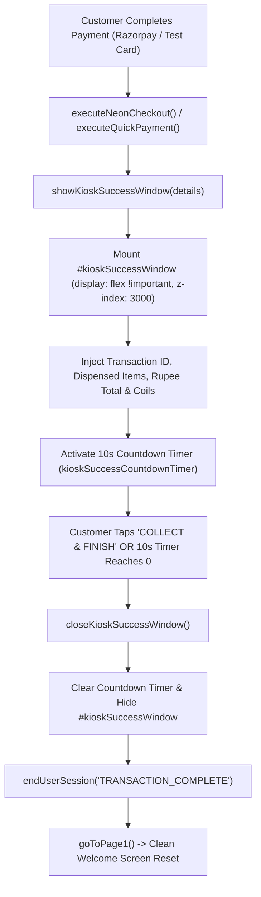

# Function Documentation: `VendingKiosk_showPaymentSuccessWindow`

- **Module / File**: `run-all.html` / `index.html`
- **Component**: `Vending Machine Frontend / Payment Settlement & Dispensing UI`
- **Author / Agent**: `Antigravity`
- **Date Created**: `2026-11-16`

---

## 1. Why Added
Following the visual design in `PICS/stitch_neon_vending_payment_sucessful (1)/code.html`, this function displays the dedicated full-screen touchscreen modal overlay when payment settlement and motor dispensing succeed. It replaces the legacy dark success modal with the modern cream (`#faf3dd`), deep forest green (`#0f2c1c`), and neon chartreuse (`#9ef01a` / `#ccff33`) aesthetic. It guides the customer to the unlocked lower retrieval hatch and renders an itemized receipt with transaction metadata and an automated 10-second session termination countdown.

---

## 2. Importance & Criticality
- **Customer Assurance & Physical Guidance**: Confirms financial settlement and immediately alerts customer that coils actuated and the physical retrieval hatch is unlocked (`HATCH UNLOCKED — PLEASE COLLECT ITEMS NOW`).
- **Telemetry & Receipt Clarity**: Itemizes all dispensed diaper products with size tags, unit prices, total settlement amount (₹), payment transaction ID, and active coil slot channels.
- **Kiosk Session Hygiene & Privacy**: Automates return to the Welcome Screen (Page 1) after 10 seconds or immediately upon tapping `COLLECT & FINISH`, preventing abandoned sessions and ensuring customer data privacy in public kiosk deployments.

---

## 3. Signature & Contracts

```typescript
export interface DispenseSuccessDetails {
  payableAmount: number;
  paymentTxId?: string;
  items?: Array<{
    name: string;
    quantity: number;
    price: number;
    meta?: string;
    size?: string;
  }>;
  slotsDispensed?: string[];
}

export function showKioskSuccessWindow(details?: DispenseSuccessDetails): void
export function closeKioskSuccessWindow(): void
```

### Parameters
- `details.payableAmount`: Numeric payable amount settled in INR.
- `details.paymentTxId`: Gateway reference transaction ID (e.g. `pay_...` from Razorpay or `TX-...`).
- `details.items`: Array of diaper items purchased with quantity, unit price, and metadata.
- `details.slotsDispensed`: Array of physical coil channel identifiers (e.g. `['A1', 'A2']`).

### Return Value
- `void`: Mutates the DOM of `#kioskSuccessWindow`, updates `#kioskSuccessReceipt`, unhides the overlay with high z-index (`3000`), and initializes the 10-second countdown interval.

---

## 4. Pipeline Integration & Flow



### Upstream Callers
- `executeNeonCheckout()`: Following successful Razorpay verification or test card checkout.
- `executeQuickPayment()`: Following demo 1-tap card checkout.
- `executeStripePayment()`: Following Stripe Elements confirmation.

### Downstream Consumers
- `closeKioskSuccessWindow()` $\rightarrow$ `endUserSession('TRANSACTION_COMPLETE')` $\rightarrow$ `goToPage1()`.
