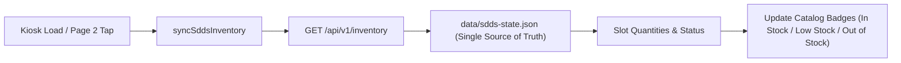

# Function: `VendingKiosk_syncSddsInventory`

- **Module / File**: `run-all.html` / `index.html`
- **Component**: `Vending Machine Frontend / Inventory Sync Engine`
- **Author / Agent**: `Antigravity`
- **Date Created**: `2026-11-16`

---

## 1. Why Added
Synchronizes the kiosk vending catalog with the single source of truth database (`data/sdds-state.json`) and Admin Hub via `GET /api/v1/inventory`. Ensures slot stock levels (`SLOT_A1` ... `SLOT_C4`) accurately reflect physical availability and prevents vending depleted products.

---

## 2. Importance & Criticality
- **Inventory Integrity (Rule 4 & 8)**: Prevents double-dispensing and out-of-stock purchases.
- **Admin Convergence**: Any restock action performed in the Admin Portal (`packages/vending-frontend/public/admin.html`) is automatically recognized by the kiosk frontend.
- **Consequences if Failed**: Customer orders might be accepted for slots with zero stock, causing dispensing motor stalls or unfulfilled orders.

---

## 3. Signature & Contracts
```typescript
function syncSddsInventory(): Promise<boolean>;
```
- **Inputs**: None.
- **Outputs**: `Promise<boolean>` returning `true` on successful sync, `false` on network fallback.
- **State Modifications**: Updates `SDDS_DIAPER_PRODUCTS[i].stock` and marks `inStock: boolean`.

---

## 4. Behavior & Logic
1. Dispatches asynchronous `fetch('/api/v1/inventory')`.
2. Parses returned slot array `data: InventorySlot[]`.
3. For each product in `SDDS_DIAPER_PRODUCTS`:
   - Matches `product.defaultLocker` with `slot.slotId`.
   - Updates product stock count: `product.stock = slot.qty`.
   - Sets `product.inStock = (slot.qty > 0 && slot.operational)`.
4. Refreshes the catalog grid view via `renderNeonProductGrid()`.
5. Updates the footer hardware telemetry badge: `Admin Cloud Sync: ONLINE`.

---

## 5. Pipeline Integration & Connection Mapping
- **Upstream Callers**: `initKioskCameraFeed()`, `goToVendingPage3()`, periodic 30-second background poll.
- **Downstream Targets**: `renderNeonProductGrid()`, `renderNeonBasket()`.


