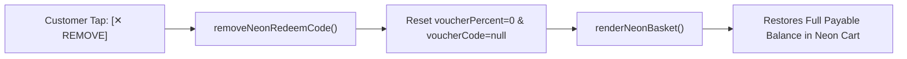

# Function: `removeNeonRedeemCode`

- **Module / File**: `run-all.html` / `index.html`
- **Component**: `Vending Machine Touchscreen Kiosk (Neon Vending Page 3)`
- **Author / Agent**: `Antigravity`
- **Date Created**: `2026-11-20`

---

## 1. Why Was This Function Added? (Rationale)
When customers applied an Eco-Reward discount code or pasted a voucher from a diaper deposit session, the discount was immediately applied and deducted from the payable total. However, there was no interactive option to cancel or remove the applied voucher if the customer entered the code by mistake, wished to save it for later, or wanted to checkout at standard pricing. `removeNeonRedeemCode()` provides a touch-ergonomic option to cancel/remove the active voucher, reset the discount to 0%, clear the input field, toggle button states back to "APPLY", and recalculate the shopping basket with non-blocking visual feedback.

---

## 2. Importance & Criticality
- **System Role**: Cart financial calculation, voucher state management, customer session hygiene.
- **Impact of Failure**: If removal fails or causes invalid state, customers cannot revert erroneous discounts, potentially locking up payment calculations or blocking valid order checkout.
- **SLA / Performance Requirement**: Immediate client-side DOM execution (< 10ms), zero network lag, zero page reloads.

---

## 3. Function Signature & Contracts

```javascript
function removeNeonRedeemCode(): void
```

### Parameters
None. Reads active window-level voucher states (`window.binDepositVoucherPercent`, `window.binDepositVoucherCode`, `window.latestBinVoucherCode`).

### Return Value
- **Type**: `void`
- **Description**: Mutates global voucher state and triggers synchronous cart re-render via `renderNeonBasket()`.

### State Mutations
- `window.binDepositVoucherPercent = 0`
- `window.binDepositVoucherCode = null`
- `window.latestBinVoucherCode = null`
- `#neonRedeemCodeInput.value = ''`
- `#btnNeonRemoveVoucher.style.display = 'none'`
- `#btnNeonApplyVoucher.style.display = 'block'`
- `#neonVoucherRow.style.display = 'none'`

---

## 4. Pipeline Integration & Connection

### Upstream Callers & Data Source
- **Trigger 1**: Customer taps `[✕ REMOVE]` button (`#btnNeonRemoveVoucher`) inside `.neon-voucher-box`.
- **Trigger 2**: Customer taps inline `[✕ Remove]` button inside `#neonVoucherRow`.

### Downstream Targets & Consumers
- **Next Stage**: `renderNeonBasket()` — recalculates GST (18%), subtotal, payable amount, and hides voucher discount line item.
- **Feedback UI**: Displays green confirmation toast inside `#neonVoucherFeedback`: `Voucher removed. Standard price restored.`

### Integration Flow Diagram


---

## 5. Memory Alignment & Resource Optimization
- Operates on primitive window attributes and lightweight DOM elements.
- Uses `clearTimeout` on `window.neonVoucherFeedbackTimer` before setting new timer to prevent memory leaks and orphaned timers.
- **Time Complexity**: $O(N)$ where $N$ is the number of cart items in `neonCartItems` during basket re-rendering.
- **Space Complexity**: $O(1)$ zero heap allocation.

---

## 6. Security Analysis
- Ensures client state is sanitized; prevents stale voucher codes from persisting across user transactions.
- Zero risk of injection: clears DOM value cleanly without `eval()` or unescaped HTML concatenation.

---

## 7. Edge Cases & Recovery Logic
1. **Calling when no voucher is applied**: Safely handles null/undefined states with defensive checks.
2. **Missing DOM elements**: Defensive `if (el)` checks ensure no JavaScript exceptions are thrown if partial DOM is rendered.
3. **Cart empty**: Safely recalculates empty cart without NaN or formatting errors.
