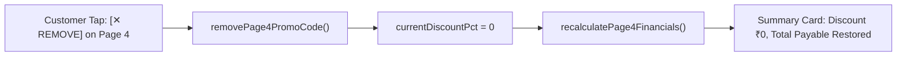

# Function: `removePage4PromoCode`

- **Module / File**: `run-all.html` / `index.html`
- **Component**: `Vending Machine Touchscreen Kiosk (Billing & Promotion Page 4)`
- **Author / Agent**: `Antigravity`
- **Date Created**: `2026-11-20`

---

## 1. Why Was This Function Added? (Rationale)
On Vending Page 4 (`viewVendingPage4`), customers can enter or paste a promo/redeem code (`applyPage4PromoCode()`). Once applied, the discount deduction was locked in with no way to remove or cancel it. `removePage4PromoCode()` allows customers to clear an applied voucher code, reset `currentDiscountPct` to 0%, clear the promo input, toggle the remove button, restore original payable amounts via `recalculatePage4Financials()`, and display clear visual confirmation.

---

## 2. Importance & Criticality
- **System Role**: Promotion management, financial summary calculation on Page 4.
- **Impact of Failure**: Customers cannot cancel or swap invalid or accidental promo codes before completing checkout or dispensing.
- **SLA / Performance Requirement**: Real-time synchronous calculation (< 5ms).

---

## 3. Function Signature & Contracts

```javascript
function removePage4PromoCode(): void
```

### Parameters
None. Operates on `currentDiscountPct`, `appliedVoucherCode`, and DOM elements `#vendingPage4PromoInput`, `#btnVendingPage4RemovePromo`, `#btnVendingPage4ApplyPromo`.

### Return Value
- **Type**: `void`
- **Description**: Resets discount state and updates Page 4 financial summary.

### State Mutations
- `currentDiscountPct = 0`
- `appliedVoucherCode = null`
- `#vendingPage4PromoInput.value = ''`
- `#btnVendingPage4RemovePromo.style.display = 'none'`
- `#btnVendingPage4ApplyPromo.style.display = 'block'`
- `#vendingPage4PromoFeedback.innerText = 'Voucher removed. Standard pricing restored.'`

---

## 4. Pipeline Integration & Connection

### Upstream Callers & Data Source
- **Trigger**: Customer taps `[✕ REMOVE]` button (`#btnVendingPage4RemovePromo`) in `.vending-promo-input-wrap`.

### Downstream Targets & Consumers
- **Next Stage**: `recalculatePage4Financials()` — recalculates itemized totals, sets discount line to 0, and updates payable amount.

### Integration Flow Diagram


---

## 5. Memory Alignment & Resource Optimization
- Direct primitive mutation and DOM attribute manipulation.
- Zero garbage collection overhead, no closures or detached node leaks.

---

## 6. Security Analysis
- Sanitizes input state and resets transaction parameters cleanly before payment initiation.

---

## 7. Edge Cases & Recovery Logic
1. **Double Tap**: Idempotent execution; repeated calls maintain 0% discount without negative totals.
2. **Zero quantity**: Safely runs through `recalculatePage4Financials()` with 0 count.
