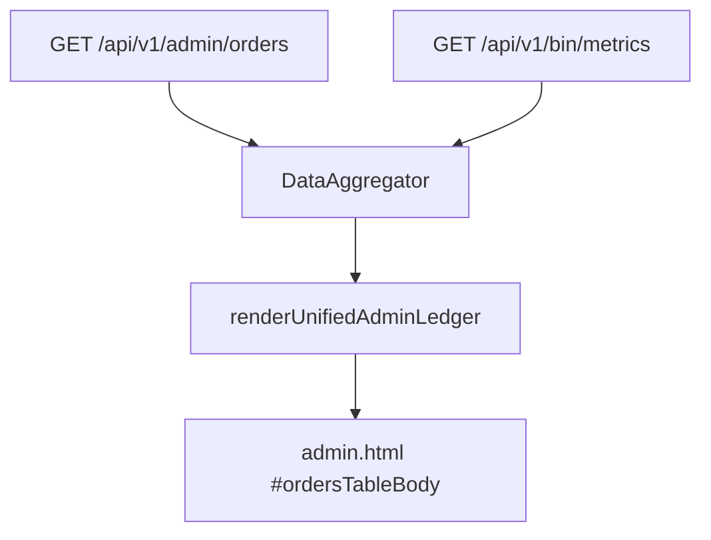

# Function Documentation: `renderUnifiedAdminLedger`

## 1. Why Added
Consolidates audit records from both the Smart Diaper Collection Bin (deposits, weights, QR verifications, vouchers issued) and the Vending Machine (purchases, payment confirmations, coil actuations) into a unified, filterable ledger in the Central Admin Portal (`admin.html`).

## 2. Importance & Criticality
Essential for machine operators and business auditing. Guarantees complete end-to-end trace from waste deposit to product purchase in a single pane of glass.

## 3. Signature & Contracts
```typescript
function renderUnifiedAdminLedger(filterType?: 'ALL' | 'BIN' | 'VENDING', searchKeyword?: string): void
```
- **Inputs**: 
  - `filterType`: Optional module filter (`'ALL'`, `'BIN'`, `'VENDING'`).
  - `searchKeyword`: Optional search string matching ID, product, or token.
- **Outputs**: Renders populated HTML table rows into `#ordersTableBody`.

## 4. Pipeline Integration


## 5. Behavior & Logic
1. Merges `vendingOrders` and `binDisposals` into a unified array tagged with `module: 'BIN' | 'VENDING'`.
2. Applies selected filter chip and search query.
3. Renders high-contrast table rows with status badges and module indicator pills.
